# Лаба 1 -- Свой Docker

Сервис `api` -- Python 3 + Flask ([main.py](main.py)). Эндпоинты:

- `GET /health` -- возвращает `ok`;
- `GET /eat?mb=N` -- выделяет N МБ и держит их;
- `GET /burn` -- бесконечный цикл, грузит одно ядро.

Стенд: Ubuntu, cgroup v2, сервис запускался из venv (`.venv/bin/python main.py`), порт 8080.

Файлы репозитория: `main.py`, `requirements.txt`, `Dockerfile`, `Dockerfile.multistage`, `mydocker.sh`, `seccomp_wrapper.py` (seccomp-профиль), `monitoring/` (cAdvisor + Prometheus + Grafana), `screenshots/`.

---

## Часть 1 -- запуск напрямую 

Сервис запущен обычным процессом, PID 40022. `/health` отдаёт `ok` и в браузере, и через `curl`. В `ps aux` процесс виден как любой другой на хосте, под моим пользователем; Flask слушает все адреса, включая физический `192.168.0.246`.

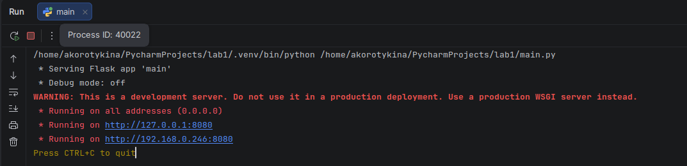

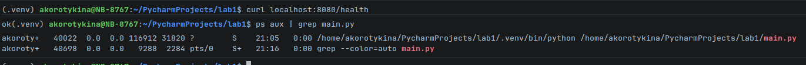

Изоляции нет: процесс видит всю систему, всю сеть хоста и может занять любое количество памяти и CPU.

---

## Часть 2 -- namespaces

Команда (от обычного пользователя, без sudo):

```bash
unshare --user --map-root-user --pid --fork --mount-proc --mount --net --uts --ipc bash
```

Внутри:

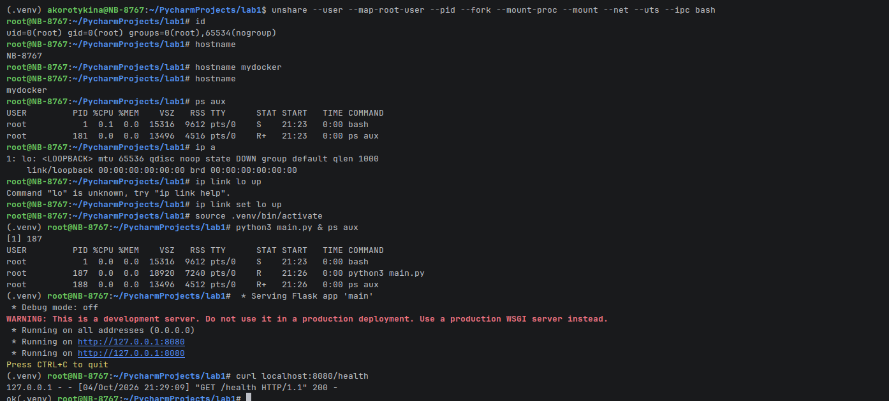

Что показал шаг:

- `ps aux` внутри: `bash` -- PID 1, затем только `ps` и `python3 main.py` (PID 187). Процессов хоста нет.
- `hostname` внутри -- `mydocker` (после `hostname mydocker`), снаружи имя хоста `NB-8767` не менялось.
- `ip a` -- только `lo`, причём `DOWN`: сеть пустая, пришлось поднять `ip link set lo up`. Flask внутри слушает только `127.0.0.1:8080`, тогда как при запуске напрямую он видел ещё и `192.168.0.246`.
- `id` -- `uid=0(root)`, но это root только внутри user namespace: на хосте процесс принадлежит обычному пользователю.
- `curl localhost:8080/health` изнутри возвращает `ok` (`GET /health 200`).

Что изолирует каждый namespace:

| Флаг | Namespace | Что изолирует |
|---|---|---|
| `--pid --fork --mount-proc` | PID | собственная нумерация процессов, процесс -- PID 1, чужие процессы не видны; `/proc` перемонтирован, иначе `ps` показывал бы хостовые |
| `--mount` | Mount | собственная таблица монтирования; перемонтирование `/proc` не влияет на хост |
| `--net` | Network | свой сетевой стек: интерфейсы, маршруты, порты; изначально только `lo` |
| `--uts` | UTS | своё имя хоста и домена |
| `--ipc` | IPC | свои очереди сообщений, семафоры, shared memory |
| `--user --map-root-user` | User | uid 0 внутри соответствует непривилегированному uid снаружи: «root» без реальных прав на хосте |

---

## Часть 3 -- cgroups v2

Создана cgroup `/sys/fs/cgroup/mydocker`. Процесс помещается в неё командой, которая записывает свой PID в `cgroup.procs` и делает `exec`, поэтому дочерние процессы автоматически внутри:

```bash
sudo sh -c 'echo $$ > /sys/fs/cgroup/mydocker/cgroup.procs && exec "$@"' sh .venv/bin/python main.py
```

### Память и OOM

Лимиты: `memory.max = 100M`, `memory.swap.max = 0` (без свопа, иначе OOM не сработает).

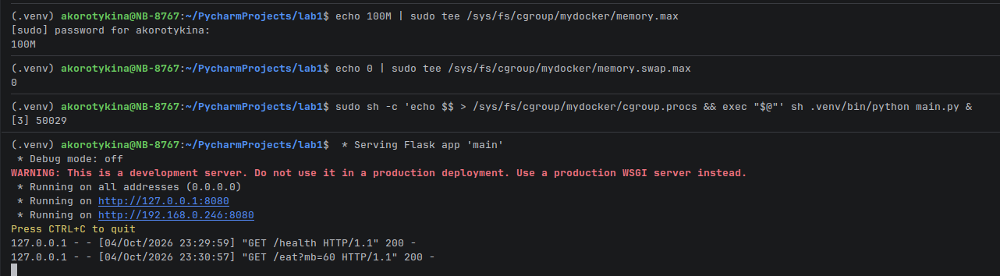
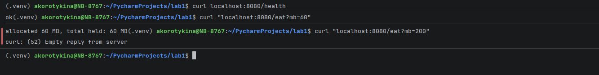
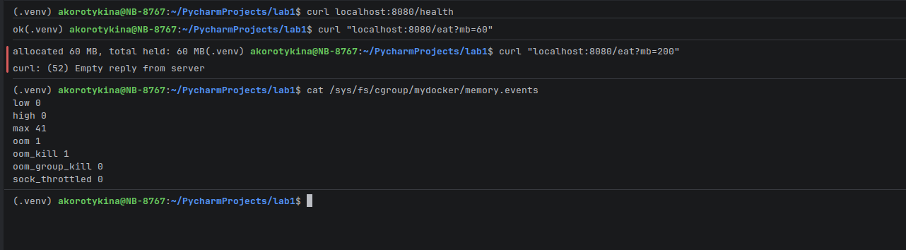

- `/eat?mb=60` -- проходит (`allocated 60 MB`).
- `/eat?mb=200` -- выше лимита: `curl: (52) Empty reply from server`, процесс убит.
- `memory.events`: `oom 1`, `oom_kill 1`, `max 41` (cgroup 41 раз упиралась в потолок и вытесняла память, прежде чем ядро убило процесс).

Это то же самое, что `OOMKilled` в Kubernetes: ядро убивает процесс, когда cgroup не может уложиться в `memory.max`.

### CPU и throttling

Лимит: `cpu.max` -- пол-ядра (50 мс из каждых 100 мс). Нагрузка -- `curl localhost:8080/burn`.

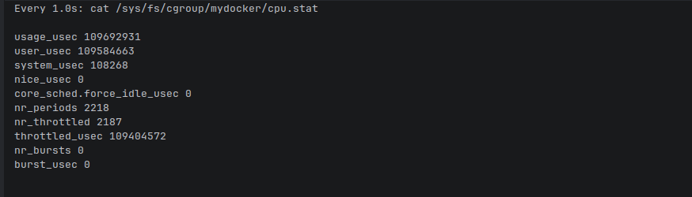
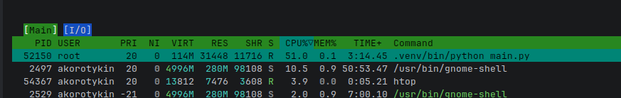

- `cpu.stat`: `nr_periods 2218`, `nr_throttled 2187` (≈99% периодов), `throttled_usec 109404572` (≈109 с принудительного простоя).
- В `htop` процесс `python main.py` держится на 51% CPU, хотя цикл без лимита занял бы 100% ядра.

### Процессы (pids.max) и форк-бомба

Лимит: `pids.max = 20`. Нагрузка: `stress-ng --fork 10 --timeout 15s` внутри cgroup.

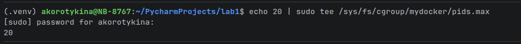
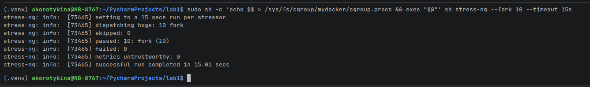
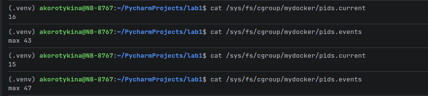

`stress-ng` считает отказ `fork()` штатной ситуацией, поэтому пишет `failed: 0` и успешно завершается. Доказательство, что расплодиться не дали, -- счётчик `max` в `pids.events`: 43 → 47 (столько попыток `fork` ядро отклонило), а `pids.current` остаётся в пределах 15–16. Система при этом осталась живой.

---

## Часть 4 -- права

### Capabilities

Привилегированное действие -- смена системного времени (нужна `CAP_SYS_TIME`):

```bash
sudo capsh --drop=cap_sys_time -- -c 'date -s "$(date)"; echo rc=$?'
# date: cannot set date: Operation not permitted
# rc=1
```

Для самого сервиса оставлен нулевой набор прав (порту 8080 привилегии не нужны):

```bash
sudo setpriv --reuid=$(id -u) --regid=$(id -g) --clear-groups \
  --bounding-set=-all --inh-caps=-all --ambient-caps=-all --no-new-privs \
  .venv/bin/python main.py
```

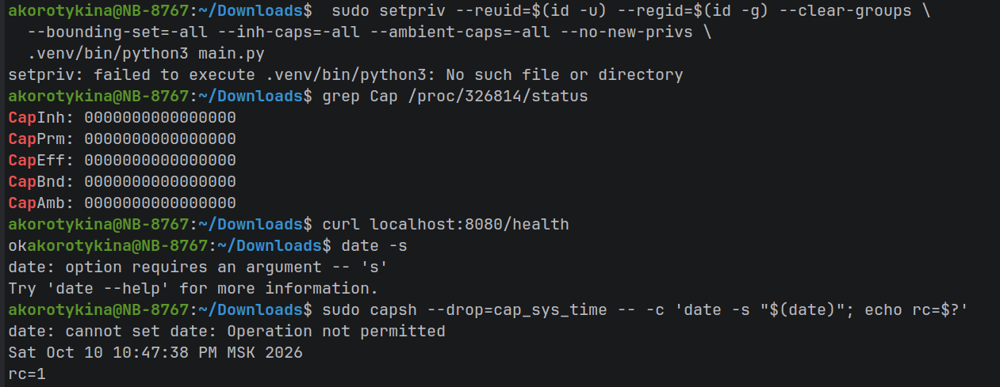
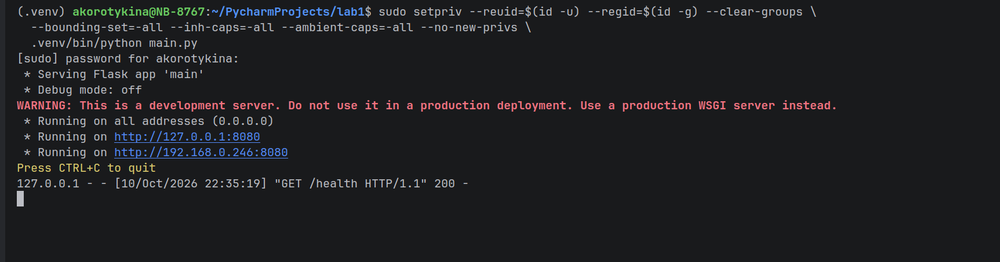

В `/proc/<PID>/status` все поля `CapInh/CapPrm/CapEff/CapBnd/CapAmb` равны `0000000000000000`, при этом `/health` отвечает `200`: сервису для работы привилегии не нужны.

### seccomp

Профиль -- `seccomp_wrapper.py`: ставит фильтр (по умолчанию всё разрешено, но `mkdir`, `mkdirat`, `settimeofday`, `clock_settime`, `reboot`, `kexec_load` возвращают `EPERM`) и затем делает `exec` целевой команды.

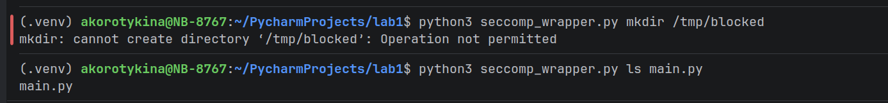

`python3 seccomp_wrapper.py mkdir /tmp/blocked` → `Operation not permitted`, а `ls main.py` под тем же фильтром работает.

### Что закрывает каждый механизм

- Capabilities делят всемогущество root на ~40 отдельных привилегий (менять время, монтировать, открывать raw-сокеты, загружать модули ядра и т.д.). Закрывают вопрос «*что* процессу разрешено делать». Вместе с `no_new_privs` процесс не получит привилегии обратно через setuid-бинарники.
- seccomp -- фильтр системных вызовов на входе в ядро. Закрывает вопрос «*какие* вызовы ядра доступны». Работает независимо от capabilities и сокращает поверхность атаки на ядро: уязвимый или ненужный syscall просто недостижим.
- namespaces (часть 2) ограничивают, *что процесс видит*; cgroups (часть 3) -- *сколько ресурсов он может взять*.

---

## Часть 5 -- свой Docker (`mydocker.sh`)

`mydocker.sh` собирает всё из частей 2–4 в одну команду:

1. под root создаёт cgroup `/sys/fs/cgroup/mydocker` и задаёт `memory.max`, `memory.swap.max=0`, `cpu.max` (0.5 ядра), `pids.max`;
2. помещает сам себя в cgroup и сбрасывает uid в обычного пользователя (`setpriv --reuid`);
3. запускает `unshare --user --map-root-user --pid --fork --mount-proc --mount --net --uts --ipc`;
4. внутри задаёт hostname, поднимает `lo`, сбрасывает все capabilities (`setpriv --bounding-set=-all ... --no-new-privs`) и запускает сервис через `seccomp_wrapper.py`.

Запуск одной командой `./mydocker.sh`:

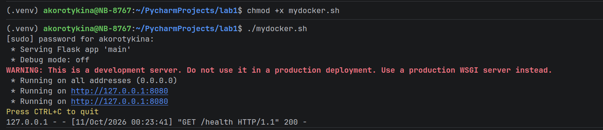

Сервис поднялся, в логе видно `GET /health 200`. Flask слушает только `127.0.0.1` (внутри пустого сетевого namespace нет ни физического интерфейса, ни моста), поэтому с хоста `/health` проверяется из сетевого namespace процесса: `sudo nsenter -t <PID> -n curl localhost:8080/health`.

### Тот же сервис через `docker run`

```bash
docker run --rm -p 8081:8080 --memory=100m --memory-swap=100m --cpus=0.5 --pids-limit=50 \
  --cap-drop=ALL --security-opt no-new-privileges mydocker-api:single
```

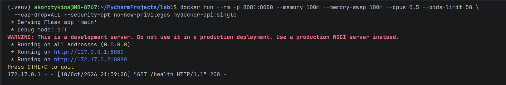
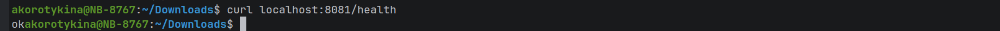

Сервис поднялся, `/health` отвечает. Сеть уже другая: у контейнера адрес `172.17.0.2` в мосту `docker0` и проброшенный порт (`-p 8081:8080`), тогда как у моего скрипта -- пустой namespace с одним `lo`.

### Сравнение

| | `mydocker.sh` | `docker run` |
|---|---|---|
| Namespaces | pid, mnt, net, uts, ipc, user | те же + cgroup namespace; user namespace по умолчанию выключен |
| Лимиты cgroup | вручную через `/sys/fs/cgroup` | флаги `--memory`, `--cpus`, `--pids-limit`; cgroup создаёт демон |
| Capabilities | сброшены все | по умолчанию урезанный набор (~14 из ~40), `--cap-drop/--cap-add` |
| seccomp | свой маленький deny-лист (6 syscalls) | встроенный профиль по умолчанию, блокирует десятки опасных вызовов |
| LSM (AppArmor/SELinux) | нет | профиль `docker-default` |
| Файловая система | хостовая (тот же `/`, venv хоста) | отдельный rootfs из слоёв образа, overlayfs, copy-on-write |
| Сеть | пустая, только `lo` (veth руками) | bridge `docker0`, NAT, DNS, проброс портов |
| Образы и слои | нет | `build/pull/push`, кэш слоёв, реестр |
| Тома, секреты | нет | volumes, bind mounts, secrets |
| Жизненный цикл | один процесс на переднем плане | демон, restart-политики, healthcheck, логи, `exec`, `stats` |
| Masked paths (`/proc/kcore` и т.п.) | нет | да |

- Совпадает: ядерные примитивы те же -- namespaces, cgroups v2, capabilities, seccomp. Docker -- это не новая технология изоляции, а их автоматизация.
- Чего нет в скрипте: собственной файловой системы (процесс видит весь хост), сети (нет моста, NAT, DNS), AppArmor, масок `/proc`, образов, управления жизненным циклом.
- Что Docker делает сверх: образы и слои с кэшированием, rootfs через overlayfs, сеть и проброс портов, тома, профили безопасности по умолчанию, демон с политиками перезапуска и наблюдаемостью.

---

## Часть 6 -- образы

`Dockerfile` -- одностадийная сборка на `python:3.11-slim-bookworm`. `Dockerfile.multistage` -- зависимости ставятся в стадии builder (`pip install --target=/deps`), в финальный образ копируется только `/deps` и `main.py`.

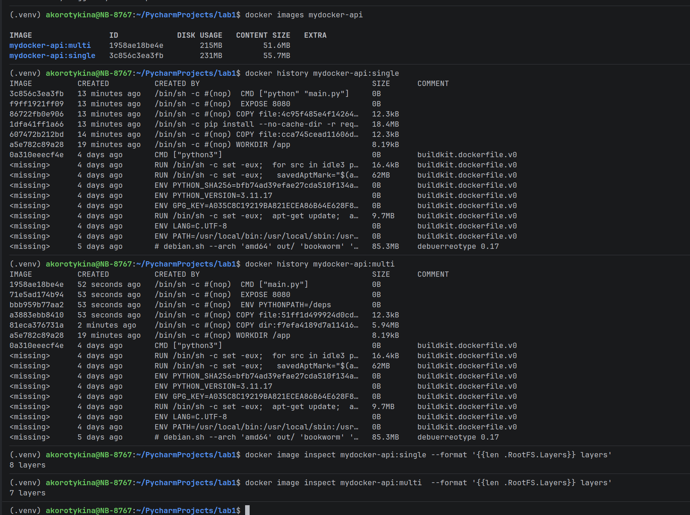

| Образ | Размер на диске | Размер содержимого | Слоёв |
|---|---|---|---|
| `mydocker-api:single` | 231 MB | 55.7 MB | 8 |
| `mydocker-api:multi` | 215 MB | 51.6 MB | 7 |

Разница небольшая, экономится только слой `pip install` против копирования готовых зависимостей.

### Кэш при повторной сборке

После `echo "# touch" >> main.py` и пересборки:

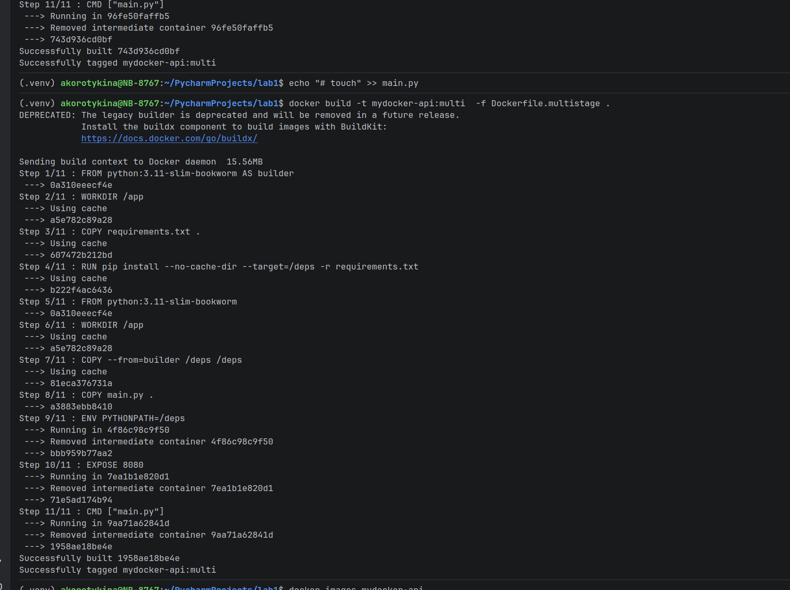

- `Using cache`: `FROM`, `WORKDIR`, `COPY requirements.txt`, `pip install` (самый дорогой шаг), `COPY --from=builder`;
- пересобираются только шаги, начиная с `COPY main.py` -- первого слоя, где изменилось содержимое; последующие слои (`ENV`, `EXPOSE`, `CMD`) идут заново, поскольку кэш инвалидируется для всех шагов после изменённого.

Поэтому в Dockerfile `requirements.txt` копируется и устанавливается до `COPY main.py`: правка кода не заставляет заново ставить зависимости.

### Данные в контейнере и том

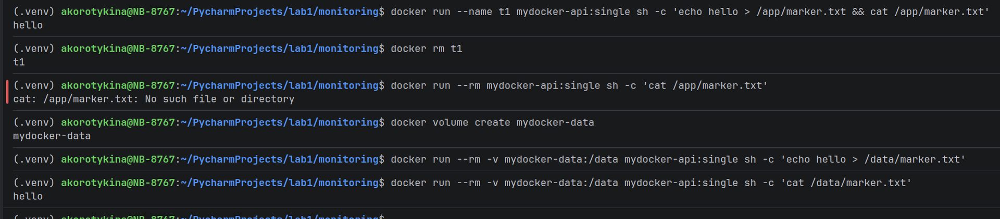

- Без тома: файл записан в `/app/marker.txt` внутри контейнера `t1`, контейнер удалён (`docker rm t1`), новый контейнер из того же образа → `cat: /app/marker.txt: No such file or directory`. Файл пропал.
- С томом `mydocker-data`, смонтированным в `/data`: файл записан одним контейнером, а новый контейнер (после `--rm` прежнего) читает `hello`. Файл остался.

Объяснение: запись идёт в тонкий записываемый слой overlayfs, который удаляется вместе с контейнером; том -- каталог на хосте (`/var/lib/docker/volumes/...`), не привязанный к жизни контейнера.

---

## Часть 7 -- gVisor

Как устроен gVisor. Между приложением и ядром хоста стоит Sentry -- «ядро» в пользовательском пространстве, которое само 
реализует системные вызовы, сетевой стек и часть файловой логики; работу с файлами делегирует отдельному процессу Gofer. Системный вызов приложения перехватывается Sentry; к настоящему ядру хоста Sentry обращается лишь узким набором вызовов, жёстко отфильтрованным seccomp. У обычного контейнера (runc) приложение обращается к ядру хоста напрямую -- с ограничениями seccomp/capabilities, но тем же ядром.

Почему считается более изолированным. Уязвимость в ядре через редкий syscall, драйвер или файловую систему из контейнера недостижима: сначала нужно скомпрометировать Sentry, а затем пройти узкий seccomp-коридор к хосту. Поверхность атаки на ядро хоста сокращается с сотен системных вызовов до нескольких десятков. Цена -- накладные расходы на перехват syscalls (особенно I/O и сеть) и неполная совместимость.

Сравнение трёх вариантов:

| | `mydocker.sh` | обычный Docker (runc) | gVisor (runsc) |
|---|---|---|---|
| Ядро, к которому идут syscalls | ядро хоста | ядро хоста | Sentry (userspace), к хосту -- минимум |
| Фильтр syscalls | свой маленький seccomp | seccomp по умолчанию | сам Sentry + seccomp на Sentry |
| Файловая система | хостовая | слои образа | слои образа через Gofer |
| Поверхность атаки на ядро хоста | широкая | широкая (урезана seccomp) | узкая |
| Накладные расходы | нет | минимальные | заметные (I/O, сеть) |

Что у обычного контейнера остаётся общим с хостом в любом случае -- ядро. Один и тот же код ядра обслуживает и хост, и все 
контейнеры; namespaces и cgroups -- лишь таблицы видимости и учёта внутри этого ядра, а не отдельные машины. Поэтому уязвимость 
ядра (побег из контейнера), общий планировщик и кэши процессора (побочные каналы вроде Spectre/Meltdown), а также ресурсы без namespace (системные часы, ключи ядра, модули ядра) затрагивают все контейнеры сразу. Это предел контейнерной изоляции: чтобы выйти за него, нужно отдельное ядро на нагрузку -- пользовательское (gVisor), микро-VM (Kata, Firecracker) или полноценная VM.

---

## Часть 8 -- мониторинг

Стек из [monitoring/](monitoring/): cAdvisor читает cgroup контейнеров, Prometheus каждые 5 секунд забирает метрики у cAdvisor, Grafana строит дашборд. Запуск: `cd monitoring && docker compose up -d`. Grafana подключена к `http://prometheus:9090`.

Дашборд: память в % от лимита, CPU в ядрах, throttling в % периодов под нагрузкой (`/eat` и `/burn` на контейнере с `--memory` и `--cpus=0.5`):

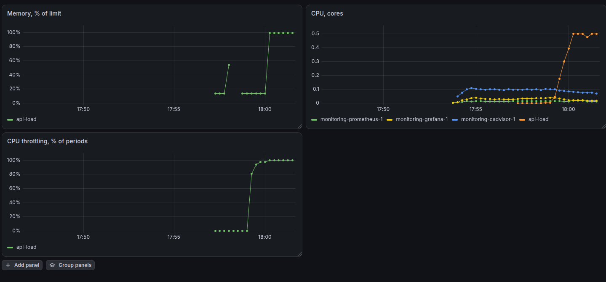

- Память: рост с ≈14% до ≈54%, затем разрыв ряда (OOM) и повторный рост до ≈99% лимита.
- CPU: потребление `api-load` поднимается к 0.5 ядра (к заданному лимиту).
- Throttling: подскакивает с 0% до ≈100% периодов и держится там. Один бесконечный цикл хочет целое ядро, а получает 0.5, поэтому упирается в квоту в каждом периоде. Совпадает с `cpu.stat` из части 3 (`nr_throttled` ≈ 99% от `nr_periods`).

### Три метрики под алерты

Правила лежат в [monitoring/alerts.yml](monitoring/alerts.yml).

1. Память к лимиту > 90% (`working_set / spec_memory_limit`). Ловит приближение к `memory.max` до того, как придёт OOM. Если пропустить -- ядро убьёт процесс (`OOMKilled`), запросы оборвутся, состояние в памяти потеряется, начнётся цикл перезапусков. Именно `working set`, а не `usage`: он не включает неактивный page cache, и по нему принимается решение об OOM.
2. Доля throttled-периодов CPU > 25% (`cfs_throttled_periods / cfs_periods`). Ловит, что лимит CPU мал для нагрузки: контейнер не падает, но «замораживается» в конце каждого периода (в части 3 было ≈99% периодов). Грозит ростом латентности (p99), таймаутами и каскадными отказами при формально «здоровом» сервисе -- самый коварный сбой, потому что нет ни ошибок, ни перезапусков.
3. Рост `container_oom_events_total`. Ловит уже свершившееся убийство процесса по памяти -- прямой признак неверного лимита или утечки. Грозит нестабильностью и потерей запросов; в отличие от п.1 это факт, а не прогноз.

