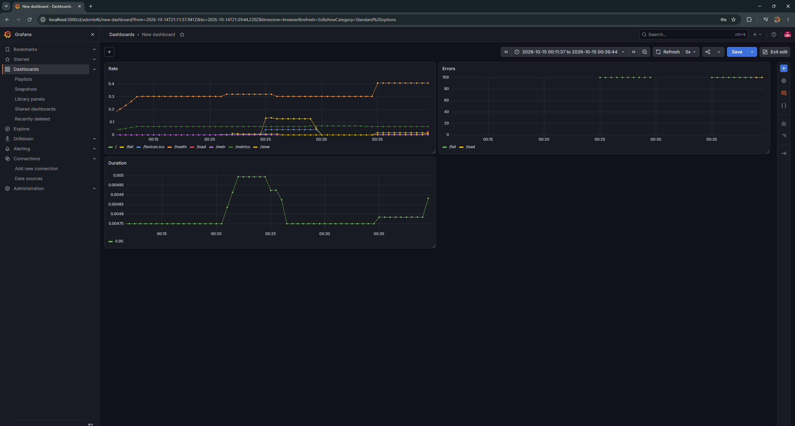
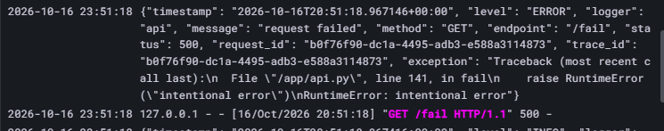
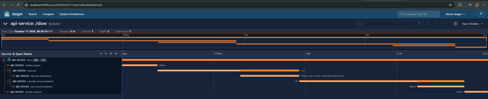
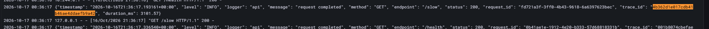
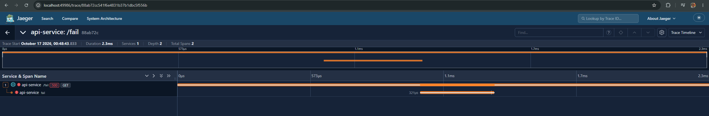
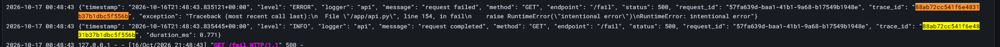
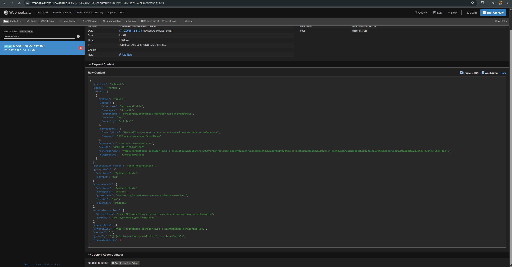
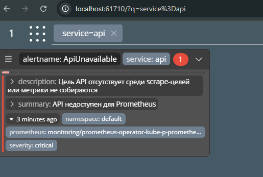
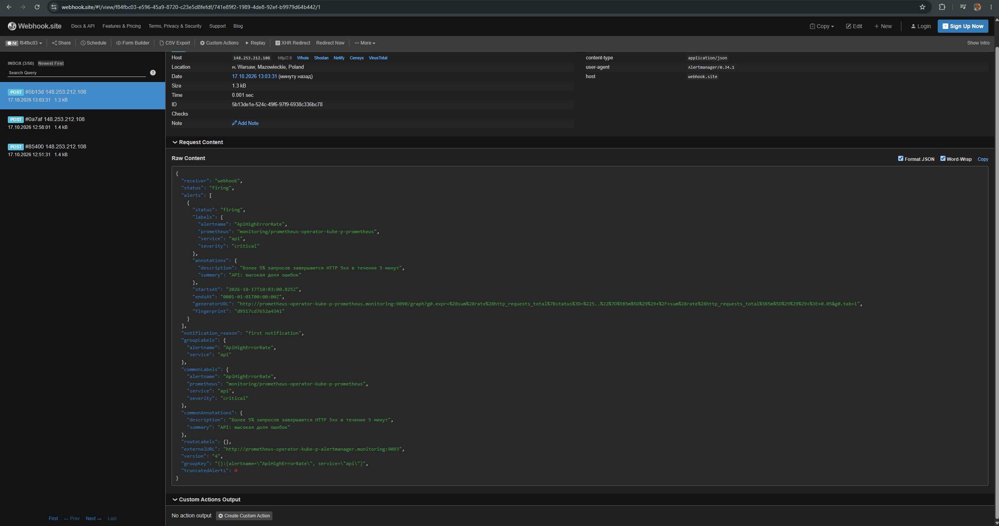
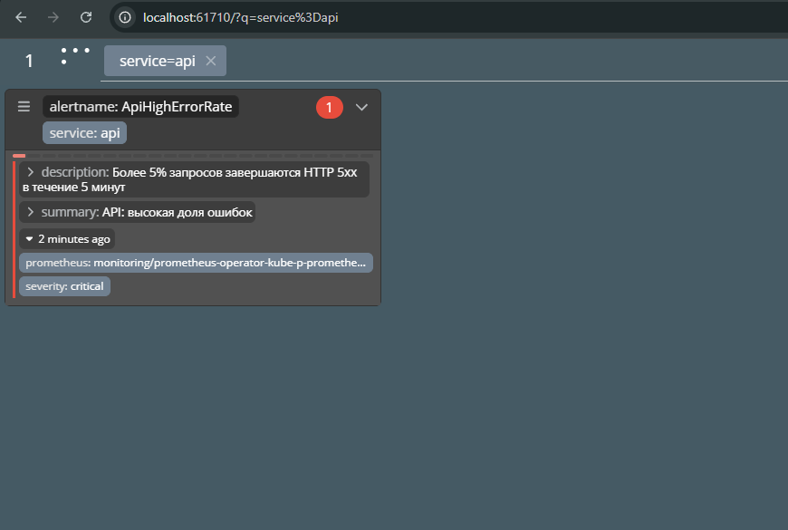

# Лабораторная 2

Используется windows с wsl

## Часть 0 — Свой сервис
Нагенерили код. Потом установили kubectl, minkube, helm

Запустили локальный кластер через minikube. Собрали образ сервиса, создали deployment и service в k8s/api.yaml.
Далее загружаем манифест в кластер и проверяем, что у нас появилась пода приложения
```commandline
vagan@vaganovyar:/mnt/d/Programming/Python/containerization-and-orchestration/lecture-2-observability/k8s$ kubectl apply -f api.yaml
deployment.apps/api created
service/api created
vagan@vaganovyar:/mnt/d/Programming/Python/containerization-and-orchestration/lecture-2-observability/k8s$ kubectl get pods
NAME                   READY   STATUS         RESTARTS   AGE
api-77bc5b745d-65fd6   0/1     ErrImagePull   0          45s
```
Но как можно заметить, приложение не поднимается, при этом образ по `docker images` имеется...

Через openlens посмотрел ошибки
> Failed to pull image "api-service:latest": failed to pull and unpack image "docker.io/library/api-service:latest": failed to resolve reference "docker.io/library/api-service:latest": pull access denied, repository does not exist or may require authorization: server message: insufficient_scope: authorization failed

Запушим образ в minikube и добавим в манифест imagePullPolicy: Never. Теперь кубер не обращается к реестру, рассчитывает, что образ уже загружен в реестр
```commandline
vagan@vaganovyar:/mnt/d/Programming/Python/containerization-and-orchestration/lecture-2-observability/k8s$ minikube image load api-service:latest
vagan@vaganovyar:/mnt/d/Programming/Python/containerization-and-orchestration/lecture-2-observability/k8s$ kubectl apply -f api.yaml
deployment.apps/api configured
service/api unchanged
vagan@vaganovyar:/mnt/d/Programming/Python/containerization-and-orchestration/lecture-2-observability/k8s$ kubectl get pods
NAME                   READY   STATUS    RESTARTS   AGE
api-7bb6997f65-f5sln   1/1     Running   0          4m12s
```

Проверим работу приложения
```commandline
vagan@vaganovyar:/mnt/d/Programming/Python/containerization-and-orchestration/lecture-2-observability/k8s$ kubectl port-forward svc/api 8080:80
Forwarding from 127.0.0.1:8080 -> 8080
Forwarding from [::1]:8080 -> 8080
Handling connection for 8080
Handling connection for 8080
vagan@vaganovyar:/mnt/d/Programming/Python/containerization-and-orchestration$ curl http://localhost:8080/health
{"status":"ok"}
```

## Часть 1 — Метрики (Prometheus + Grafana)
Поднимаем prometheus и grafana через helm, используя kube-prometheus-stack чарт
```commandline
vagan@vaganovyar:/mnt/d/Programming/Python/containerization-and-orchestration/lecture-2-observability/k8s$ helm repo add prometheus-community https://prometheus-community.github.io/helm-charts
"prometheus-community" has been added to your repositories
vagan@vaganovyar:/mnt/d/Programming/Python/containerization-and-orchestration/lecture-2-observability/k8s$ helm repo update
Hang tight while we grab the latest from your chart repositories...
...Successfully got an update from the "prometheus-community" chart repository
Update Complete. ⎈Happy Helming!⎈
vagan@vaganovyar:/mnt/d/Programming/Python/containerization-and-orchestration/lecture-2-observability/k8s$ helm install prometheus-operator prometheus-community/kube-prometheus-stack   --namespace monitoring   --create-namespace
NAME: prometheus-operator
LAST DEPLOYED: Wed Oct 14 21:33:34 2026
NAMESPACE: monitoring
STATUS: deployed
REVISION: 1
DESCRIPTION: Install complete
NOTES:
...
```
Далее создадим [api-service-monitor.yaml](k8s/api-service-monitor.yaml), в котором укажем prometheus откуда и как скрапить метрики. После применяем описанные правила
```commandline
vagan@vaganovyar:/mnt/d/Programming/Python/containerization-and-orchestration/lecture-2-observability/k8s$ kubectl apply -f api-service-monitor.yaml
servicemonitor.monitoring.coreos.com/api-monitor created
vagan@vaganovyar:/mnt/d/Programming/Python/containerization-and-orchestration/lecture-2-observability/k8s$ kubectl get svc -n monitoring
NAME                                           TYPE        CLUSTER-IP       EXTERNAL-IP   PORT(S)                      AGE
alertmanager-operated                          ClusterIP   None             <none>        9093/TCP,9094/TCP,9094/UDP   28m
prometheus-operated                            ClusterIP   None             <none>        9090/TCP                     28m
prometheus-operator-grafana                    ClusterIP   10.99.171.30     <none>        80/TCP                       28m
prometheus-operator-kube-p-alertmanager        ClusterIP   10.102.89.104    <none>        9093/TCP,8080/TCP            28m
prometheus-operator-kube-p-operator            ClusterIP   10.102.124.239   <none>        443/TCP                      28m
prometheus-operator-kube-p-prometheus          ClusterIP   10.97.0.244      <none>        9090/TCP,8080/TCP            28m
prometheus-operator-kube-state-metrics         ClusterIP   10.110.234.91    <none>        8080/TCP                     28m
prometheus-operator-prometheus-node-exporter   ClusterIP   10.105.26.255    <none>        9100/TCP                     28m
```
Подключимся к графане
```commandline
vagan@vaganovyar:/mnt/d/Programming/Python/containerization-and-orchestration/lecture-2-observability/k8s$ kubectl port-forward -n monitoring svc/prometheus-operator-grafana 3000:80
Forwarding from 127.0.0.1:3000 -> 3000
Forwarding from [::1]:3000 -> 3000
Handling connection for 3000
Handling connection for 3000
```
Получаем пароль и заходим в гарфану
```commandline
vagan@vaganovyar:/mnt/d/Programming/Python/containerization-and-orchestration/lecture-2-observability/k8s$ kubectl get secret prometheus-operator-grafana -n monitoring -o jsonpath='{.data.admin-password}' | base64 -d
auVBkB6jjInrOG1nGI6RItizEmktMFBaXpgLmHck
```
Создал дашборд со следующими RED метриками
```
Rate
sum(rate(http_requests_total[5m])) by (exported_endpoint)

Errors
100 * (
    sum(rate(http_requests_total{status=~"5.."}[5m])) by (exported_endpoint) /
    sum(rate(http_requests_total[5m])) by (exported_endpoint)
)

Duration
histogram_quantile(0.95, sum(rate(http_request_duration_seconds_bucket[5m])) by (le))
```


## Часть 2 — Логи (Loki + Grafana)
Поднимаем Loki + Promtail так же через helm charts
```commandline
vagan@vaganovyar:/mnt/d/Programming/Python/containerization-and-orchestration$ helm repo add grafana https://grafana.github.io/helm-charts
"grafana" has been added to your repositories
vagan@vaganovyar:/mnt/d/Programming/Python/containerization-and-orchestration$ helm repo update
Hang tight while we grab the latest from your chart repositories...
...Successfully got an update from the "grafana" chart repository
...Successfully got an update from the "prometheus-community" chart repository
Update Complete. ⎈Happy Helming!⎈
vagan@vaganovyar:/mnt/d/Programming/Python/containerization-and-orchestration$ helm upgrade --install loki grafana/loki-stack \
  -n monitoring \
  --set grafana.enabled=false \
  --set loki.isDefault=false \
  --set promtail.enabled=true
Release "loki" does not exist. Installing it now.
level=WARN msg="this chart is deprecated"
NAME: loki
LAST DEPLOYED: Thu Oct 15 23:23:10 2026
NAMESPACE: monitoring
STATUS: deployed
REVISION: 1
DESCRIPTION: Install complete
NOTES:
The Loki stack has been deployed to your cluster. Loki can now be added as a datasource in Grafana.
```
Пытался добавить в grafana data source loki, но графана не подключалась к loki. loki-stack уже deprecated.
Поставил loki + promtail по отдельности, помогло
```commandline
vagan@vaganovyar:/mnt/d/Programming/Python/containerization-and-orchestration/lecture-2-observability/k8s$ helm upgrade --install loki grafana-community/loki -f loki-values.yaml -n monitoring
NAME: loki
LAST DEPLOYED: Fri Oct 16 22:42:23 2026
NAMESPACE: monitoring
STATUS: deployed
REVISION: 1
DESCRIPTION: Install complete
NOTES:
...
vagan@vaganovyar:/mnt/d/Programming/Python/containerization-and-orchestration/lecture-2-observability/k8s$ helm upgrade --install promtail grafana/promtail -n monitoring \
  --set "config.clients[0].url=http://loki-gateway.monitoring.svc:80/loki/api/v1/push"
Release "promtail" does not exist. Installing it now.
level=WARN msg="this chart is deprecated"
NAME: promtail
LAST DEPLOYED: Fri Oct 16 22:44:02 2026
NAMESPACE: monitoring
STATUS: deployed
REVISION: 1
DESCRIPTION: Install complete
TEST SUITE: None
NOTES:
...
vagan@vaganovyar:/mnt/d/Programming/Python/containerization-and-orchestration/lecture-2-observability/k8s$ kubectl get pod -n monitoring
NAME                                                      READY   STATUS    RESTARTS      AGE
alertmanager-prometheus-operator-kube-p-alertmanager-0    2/2     Running   2 (24h ago)   47h
loki-0                                                    2/2     Running   0             7m4s
loki-canary-b7m7x                                         1/1     Running   0             6m38s
loki-chunks-cache-0                                       2/2     Running   0             14m
loki-gateway-7d77f85bc7-hd2jt                             2/2     Running   0             14m
loki-results-cache-0                                      2/2     Running   0             14m
prometheus-operator-grafana-585c9b7d59-8mqgg              3/3     Running   0             22h
prometheus-operator-kube-p-operator-5f5546df86-kgf8k      1/1     Running   0             22h
prometheus-operator-kube-state-metrics-6d59fd4f6c-4kvpm   1/1     Running   0             22h
prometheus-operator-prometheus-node-exporter-6jzpm        1/1     Running   1 (24h ago)   47h
prometheus-prometheus-operator-kube-p-prometheus-0        2/2     Running   2 (24h ago)   47h
promtail-hwwmx                                            1/1     Running   0             12m
```
Видим логи с ошибками в grafana



## Часть 3 — Трейсы (OpenTelemetry + Jaeger)
Поднимаем Jaeger
```commandline
vagan@vaganovyar:/mnt/d/Programming/Python/containerization-and-orchestration/lecture-2-observability/k8s$ helm repo add jaegertracing https://jaegertracing.github.io/helm-charts
"jaegertracing" has been added to your repositories
vagan@vaganovyar:/mnt/d/Programming/Python/containerization-and-orchestration/lecture-2-observability/k8s$ helm repo update
Hang tight while we grab the latest from your chart repositories...
...Successfully got an update from the "jaegertracing" chart repository
...Successfully got an update from the "grafana-community" chart repository
...Successfully got an update from the "grafana" chart repository
...Successfully got an update from the "prometheus-community" chart repository
Update Complete. ⎈Happy Helming!⎈
vagan@vaganovyar:/mnt/d/Programming/Python/containerization-and-orchestration/lecture-2-observability/k8s$ helm upgrade --install jaeger jaegertracing/jaeger -f jaeger-values.yaml -n monitoring
Release "jaeger" does not exist. Installing it now.
NAME: jaeger
LAST DEPLOYED: Sat Oct 17 00:03:06 2026
NAMESPACE: monitoring
STATUS: deployed
REVISION: 1
DESCRIPTION: Install complete
TEST SUITE: None
NOTES:
...
```
Для того чтобы указать адрес jaeger добавил переменные окружения в api и передеплоил
```yaml
env:
  - name: OTEL_EXPORTER_OTLP_ENDPOINT
    value: "http://jaeger.monitoring.svc.cluster.local:4317"
```
Результаты дергания /slow

По этому трейсу имеется лог

Результаты дергания /fail

По этому трейсу имеется лог


## Часть 4 — Алерты (Alertmanager + Karma)
Напишем алерты. Добавили алерты на высокую долю ошибок, высокий latency, недоступность метрик или сервиса. Применим алерты
```commandline
vagan@vaganovyar:/mnt/d/Programming/Python/containerization-and-orchestration/lecture-2-observability/k8s$ kubectl apply -f alerts.yaml
prometheusrule.monitoring.coreos.com/api-alerts created
vagan@vaganovyar:/mnt/d/Programming/Python/containerization-and-orchestration/lecture-2-observability/k8s$ kubectl get prometheusrule -n monitoring
NAME                                                              AGE
api-alerts                                                        42s
...
```
alertmanager шел в комплекте с kube-prometheus-stack. Добавили конфиг alertmanager, применяем его
```commandline
vagan@vaganovyar:/mnt/d/Programming/Python/containerization-and-orchestration/lecture-2-observability/k8s$ helm upgrade prometheus-operator prometheus-community/kube-prometheus-stack \
  -n monitoring \
  -f alertmanager-values.yaml
Release "prometheus-operator" has been upgraded. Happy Helming!
NAME: prometheus-operator
LAST DEPLOYED: Sat Oct 17 12:02:03 2026
NAMESPACE: monitoring
STATUS: deployed
REVISION: 5
DESCRIPTION: Upgrade complete
NOTES:
...
```
Теперь поднимем Karma, используя манифест
```commandline
vagan@vaganovyar:/mnt/d/Programming/Python/containerization-and-orchestration/lecture-2-observability/k8s$ kubectl apply -f karma.yaml
deployment.apps/karma created
service/karma created
```
Заскейлил в 0 деплой api, должен был сработать алерт с недоступностью метрик или сервиса. Алерты пришли

Дашборд в Karma



Потом поднял приложение и алерт ушел. Потом стал отправлять /fail в сервис, снова пришел алерт, но уже другой на высокую долю ошибок

Дашборд в Karma

