## Часть 1
Выбор движка: Kyverno. 

    - Политики — обычные Kubernetes-манифесты (YAML), не нужно учить Rego.
    - Проще отлаживать в локальном кластере.
    - Встроенные типы правил (validate, mutate, generate) покрывают требования лабы.

    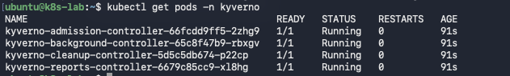

Выбранные политики

    - Лимиты: понятно, не даст одному поду съесть все ресурсы ноды.
    - Реестр: снижает риск supply-chain атак, запрещая образы из неизвестных источников.
    - Метки: обеспечивают управляемость (например, для сетевых политик или распределения затрат).
    - Privileged: блокирует контейнеры с правами хоста, которые могут скомпрометировать всю ноду.
    - latest: гарантирует воспроизводимость развертывания (тег latest может измениться в любой момент) (помню историю из лекции).

    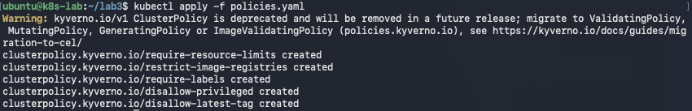

Далее создаем манифесты, нарушающие одно из правил политики. Как и ожидалось Kyverno не дает их применить. Некоторые манифесты нарушают сразу несколько правил. 1-й отклонен из-за отсутствия ограничения ресурсов, 2-й - образ не из docker.io/library/, 3-й - отсутствуют team и environment, 4-й - так как privileged: true, 5-й - используется тег latest.

    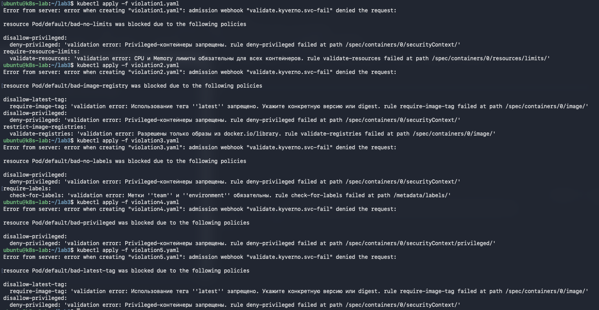

## Часть 2

При попытке поднять Postgres и мониторинг наткнулся на собственные ограничения policies. Решил путем добавления исключений в правила Kyverno. Обоснование: политики для приложений не должны ломать системные компоненты кластера.

С 7-й итерации все поднялось, рад!
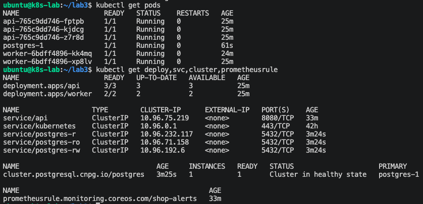

Удалаяю под api в ручную, поднимается автоматически. В деле декларативный подход в Deployment. Контроллер видит расхождение между желаемым и фактическим состоянием и поднимает новый под. Это и есть reconciliation - контроллер постоянно приводит факт к желаемому.
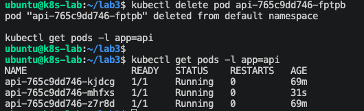

Поменял значение replicas в values.yaml для api на 4; helm upgrade рендерит шаблон с новым значением {{ .Values.api.replicas }} и обновляет Deployment; контроллер масштабирует ReplicaSet. 
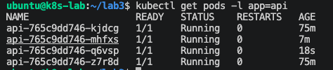

*rolling update*
Пересобрал Docker-образ для api, загрузил в kind, сделал helm upgrade. В процессе перезапуска подов всегда были поды в состоянии Running. Все запросы вернулись с кодом 200. В процессе обновления сервис всегда оставался доступным.

    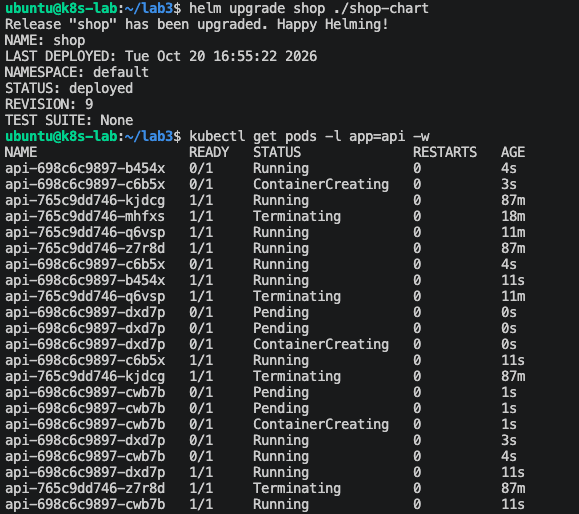

    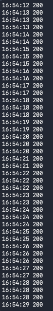

Далее выкатил сломанную версию, сделал helm upgrade. Новый под стартует, но не проходит readinessProbe. Из-за этого старые поды не удалаются, сервис возвращает код 200. Жизнеспособность сервиса сохраняется, все отлично.

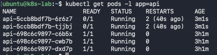

```
ubuntu@k8s-lab:~$ kubectl rollout status deploy/api
Waiting for deployment "api" rollout to finish: 2 out of 4 new replicas have been updated...
```

После Rollback контроллер привел кластер к изначальному состоянию, воссоздался один под, который был удален при развертывании поломанной версии. При этом в процессе сервис отвечал, потерянных запросов нет.
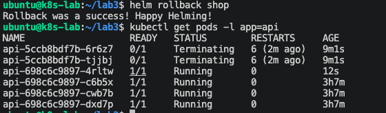

## Часть 3

CloudNativePG уже был развернут, шаблон в чарт для Cluster CloudNativePG также имеется.

При удалении пода с Postgres оператор CNPG восстановил кластер. При удалении пода оператор видит расхождение и пересоздаёт его. По сути, это тот же reconciliation, что и у Deployment.

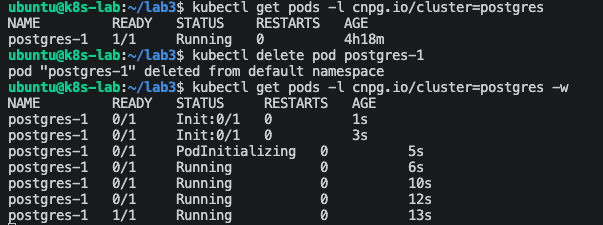

controller-manager - встроенный компонент Kubernetes c набором контроллеров для встроенных типов: Deployment, ReplicaSet, StatefulSet, Job, Node, Endpoint. Он не знает ничего о Postgres.

Оператор - это пользовательский контроллер, который работает с CRD (Cluster). Он знает специфику домена: как инициализировать БД, как настроить репликацию, как сделать failover, как бэкапить. Своего рода controller-manager для приложения, который ты ставишь отдельно.

## Часть 4
Оставновил control plane, helm upgrade, kubectl apply отвечают отказами. Не смог напрямую проверить здоровье сервиса, поскольку port-forward был проброшен на под, который завершился. НО по косвенным признакам (время жизни других подов и их неизменившиеся имена) можно сделать вывод, что реплики api остались живы. Тезис о том, что при остановленном contol plane сервис продолжает работать, считаю доказанным. После восстановления control plane kubectl стал отвечать.
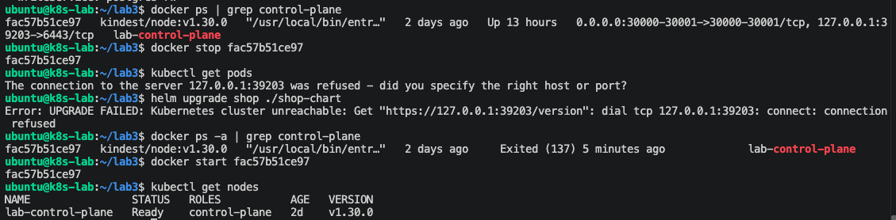

## Часть 5

Изначально был алерт
ApiDown (up{job="api"} == 0, for 1m), но эксперимент не удался, поскольку метрика отслеживается с особенностями. 

В итоге выбрал такие алерты

ApiNoReadyReplicas (kube_deployment_status_replicas_ready{deployment="api"} == 0) - отсутствуют Running реплики API, сервис недоступен

HighErrorRate (rate(http_requests_total{status=~"5.."}[5m]) > 0.1, for 2m) - растёт доля 5xx. Может быть проблема с БД, кодом или зависимостью. Warning, потому что сервис ещё отвечает, но деградирует.

PostgresNotReady (cnpg_collector_up == 0, for 1m) - оператор не может поддерживать кластер БД, данные под угрозой. Critical.

