# Лаба 4. SLA критического пути под перегрузкой

Критический путь: оформление заказа `api -> postgres`. Второстепенная нагрузка: `batch` (ночная аналитика). Вся настройка сделана через Helm-чарт [shop/](shop/).

Площадка: kind, 2 ноды (`shop-control-plane` без taint и `shop-worker`). Обе ноды это контейнеры на одном хосте, и каждая видит все его ресурсы. Поэтому в [kind-config.yaml](kind-config.yaml) каждой ноде урезана половина CPU (`systemReserved`) и часть памяти (`evictionHard.memory.available`). Без этого планировщик считал бы, что ресурсов вдвое больше, чем есть, а kubelet не заметил бы давления по памяти до OOM-killer'а ядра. Части 6 и 7 сначала шли на Docker Desktop с 4 CPU / 8 GB и порогом `4608Mi`. После зависания VM в Части 7 Docker Desktop переведён на 12 GB, порог на `60%`.

## Часть 0. batch

[batch/batch.py](batch/batch.py) в бесконечном цикле набирает `BATCH_MEMORY_MB` памяти шагами по `BATCH_STEP_MB` в секунду и крутит sha256 долю `BATCH_CPU_DUTY` каждой секунды. Память набирается постепенно, чтобы kubelet успел заметить давление и выселить под раньше, чем сработает OOM-killer ядра. Параметры задаются в `values.yaml` (`batch.memoryMB`, `stepMB`, `cpuDuty`).

## Часть 1. Механизм разнесения

Параметр `api.spread.mode` в [values.yaml](shop/values.yaml): `none | antiAffinity | topologySpread`.

| | `podAntiAffinity` | `topologySpreadConstraints` |
|---|---|---|
| Правило | не ставить под рядом с подом с меткой X (нода либо подходит, либо нет) | разница числа подов между доменами топологии не больше `maxSkew` |
| Реплик больше, чем нод | `required`: лишние висят в `Pending`; `preferred`: размещаются как получится, баланс не гарантирован | при `maxSkew: 1` раскладывает равномерно: 2+2, 3+2 и т.д. |
| Масштабирование | при 4 репликах на 2 нодах `required` не работает | работает при любом числе реплик |
| Rolling update | старые реплики мешают новым (при `required` и `maxSurge` новая реплика может не встать) | с `matchLabelKeys: [pod-template-hash]` баланс считается внутри одной ревизии |
| Стоимость для планировщика | O(подов × нод), дорого на больших кластерах | дешевле |

Выбран `topologySpread` (`maxSkew: 1`, `whenUnsatisfiable: DoNotSchedule`, `topologyKey: kubernetes.io/hostname`). Нод всего две, а реплик `api` бывает больше (в Части 6 их 4). Жёсткий anti-affinity оставил бы лишние реплики в `Pending`, мягкий не гарантировал бы разнесение. Spread даёт и гарантию (на одной ноде не больше, чем на соседней, плюс один), и масштабирование. Тот же механизм без изменений переносится на зоны (`topology.kubernetes.io/zone`). Anti-affinity оставлен в шаблоне как альтернатива.

## Часть 2. Тесная площадка

`batch` добавлен шаблоном [batch-deployment.yaml](shop/templates/batch-deployment.yaml) с requests `100m/32Mi` и limits `300m/768Mi`. Гвардрейлы Kyverno из Лабы 3 действуют без исключений, в [policies.yaml](policies.yaml) только добавлен разрешённый образ `shop-batch:*`. Деплой через `helm upgrade --install` с оверлеем: числа из Лабы 3, без разнесения, приоритетов и PDB.

## Часть 3. krr вместо угадывания

Нагрузка: k6, `constant-arrival-rate`, 30 заказов/с. Затем `krr simple -n shop -p http://localhost:9090 --history_duration 1 --points_required 10`, отчёт в [krr/krr-report.txt](krr/krr-report.txt).

Первый запуск krr против изначальной догадки, в колонке Diff видно расхождение:

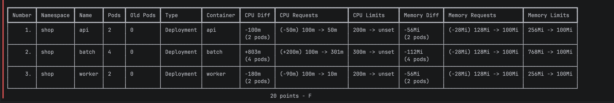

Повторный запуск на финальных числах:

```
Name    CPU Requests          CPU Limits     Memory Requests         Memory Limits
api     (-55m)  100m -> 45m   100m -> unset  (+0m)   100Mi -> 100Mi  100Mi -> 100Mi
batch   (+200m) 100m -> 301m  300m -> unset  (+666Mi) 32Mi -> 698Mi  768Mi -> 698Mi
worker  (+0m)   10m  -> 10m   50m  -> unset  (+0m)   100Mi -> 100Mi  100Mi -> 100Mi
```

postgres в отчёт krr не попал: его поды принадлежат CRD `Cluster` из CNPG, а не Deployment или StatefulSet. Для него числа посчитаны вручную в Prometheus по тому же алгоритму, что у krr `simple`: CPU как p95, память как максимум плюс 15%.

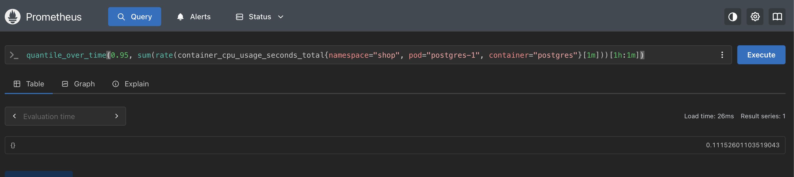

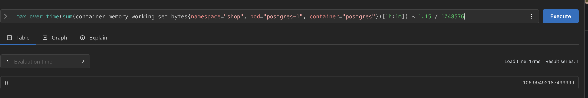

| Сервис | Догадка (Лаба 3), req / lim | krr | В `values.yaml` |
|---|---|---|---|
| api | CPU 100m / 200m, mem 128Mi / 256Mi | CPU 45-50m, mem 100Mi | CPU 100m / 100m, mem 100Mi / 100Mi (Guaranteed) |
| worker | CPU 100m / 200m, mem 128Mi / 256Mi | CPU 10m, mem 100Mi | CPU 10m / 50m, mem 100Mi / 100Mi (Burstable) |
| postgres | CPU 100m / 500m, mem 256Mi / 512Mi | CPU 111m, mem 107Mi | CPU 150m / 150m, mem 256Mi / 256Mi (Guaranteed) |
| batch | CPU 100m / 300m, mem 128Mi / 768Mi | CPU 301m, mem 698Mi | не переносилось: 100m / 300m, 32Mi / 768Mi (Burstable) |

Почему разошлось:

- Память api и worker была завышена в 1.3-2.5 раза. Flask с psycopg2 держит 30-50 МиБ: процесс ничего не кэширует. На кластере из двух нод лишние 128-256Mi это резерв, который планировщик вычитает из allocatable.
- CPU api завышен вдвое. При 30 заказах/с api тратит 15-50m, почти всё время он ждёт postgres.
- worker почти не потребляет CPU (10m вместо 100m): один UPDATE раз в 5 секунд.
- По CPU postgres догадка оказалась близкой (100m против 111m), а лимит 500m был с пятикратным запасом. По памяти krr насчитал 107Mi, но оставлено 256Mi, потому что `shared_buffers` по умолчанию 128MB. В Части 8 выяснилось, что под перегрузкой не хватает и этого.
- Для batch рекомендации krr бессмысленны. batch съедает всё, что разрешает лимит, поэтому p95 CPU упирается в 300m, и krr предлагает больше (301m). Для второстепенной нагрузки requests определяются приоритетом, а не потреблением.
- krr `simple` советует CPU request = p95 и не задаёт CPU limit, потому что лимит вызывает троттлинг. Для QoS Guaranteed нужен `limit = request`, а гвардрейлы требуют лимит, поэтому CPU округлён вверх: api 45m до 100m, postgres 111m до 150m.

## Часть 4. Разнесение api

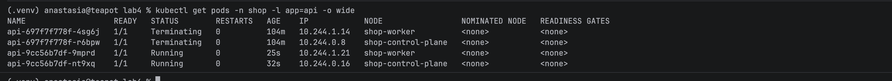

Реплики `api` стоят на разных нодах. Если одна нода откажет (железо, kernel panic, `drain`, перезагрузка), пропадёт только часть реплик. Service продолжит отправлять трафик на оставшиеся, а Deployment тем временем поднимет замену. Без разнесения планировщик мог бы поставить все реплики на одну ноду, и её отказ положил бы весь сервис.

## Часть 5. Приоритеты, QoS, PDB

Шаблоны: [priorityclasses.yaml](shop/templates/priorityclasses.yaml), [pdb.yaml](shop/templates/pdb.yaml). Значения в секциях `priorityClasses` и `pdb` файла [values.yaml](shop/values.yaml).

| Под | QoS | PriorityClass | PDB |
|---|---|---|---|
| api | Guaranteed (req = lim, числа krr) | `shop-critical` (100000) | `minAvailable: 1` |
| postgres | Guaranteed | `shop-critical` | `minAvailable: 1` (собственный PDB оператора выключен через `enablePDB: false`, чтобы не было двух) |
| worker | Burstable | `shop-standard` (1000) | нет |
| batch | Burstable (32Mi / 768Mi) | `shop-batch` (-100, `preemptionPolicy: Never`) | нет |

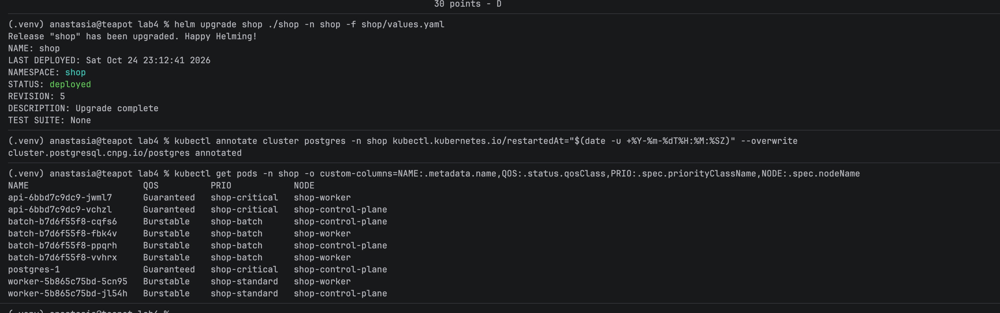

Что даёт каждая настройка под давлением:

- `shop-critical`: если `api` или `postgres` не помещаются, планировщик вытесняет (preemption) поды с более низким приоритетом. Кроме того, приоритет учитывается kubelet при выселении.
- `shop-batch` со значением -100: это ниже дефолтного 0, который получают поды без класса (мониторинг, Kyverno). Иначе kubelet мог бы выселить Prometheus раньше batch. `preemptionPolicy: Never` запрещает batch вытеснять других, он только ждёт в очереди.
- QoS Guaranteed (requests = limits по CPU и памяти во всех контейнерах): `oom_score_adj = -997`, и OOM-killer ядра трогает такой под последним. Потребление не превышает requests, поэтому при давлении по памяти kubelet выберет его, только когда других кандидатов не останется. CPU-лимит совпадает с резервом.
- QoS Burstable у batch: `oom_score_adj` от 2 до 999 (чем меньше request относительно памяти ноды, тем выше). Под может потреблять больше requests, пока на ноде есть место, и как раз это превышение делает его первым кандидатом на выселение.
- PodDisruptionBudget защищает от добровольных нарушений через Eviction API: `kubectl drain`, обновление нод, autoscaler. Он не даст убрать последнюю реплику `api` или `postgres`. От выселения kubelet при нехватке ресурсов PDB не защищает, а при preemption учитывается только по возможности. В этих случаях работают приоритет и QoS.

Порядок выселения Burstable и Guaranteed. При нехватке памяти kubelet сортирует поды по трём признакам: превышает ли потребление requests, приоритет, на сколько превышает. Guaranteed никогда не превышает requests и оказывается в конце очереди. Burstable, который потребляет больше requests, оказывается в начале, и среди таких первым идёт под с меньшим приоритетом. Отдельно от kubelet ядро при глобальном OOM убивает процесс с наибольшим `oom_score`: у Burstable он высокий, у Guaranteed минимальный. BestEffort (без requests и limits) шёл бы первым, но гвардрейлы его запрещают. Поэтому batch менее защищён из-за класса и приоритета, а не из-за отсутствия лимитов.

## Часть 6. Pending и preemption

`batch.replicas` поднят с 4 до 30, часть подов осталась в `Pending`.

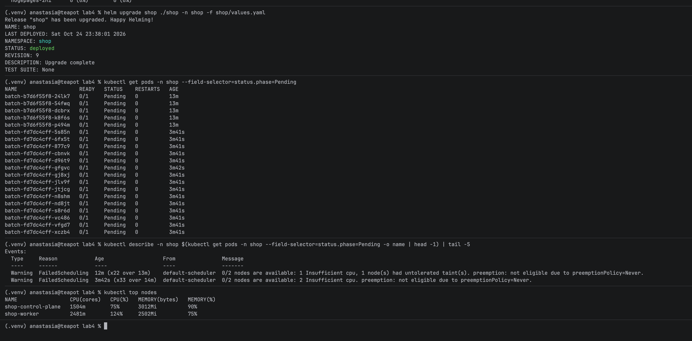

Наблюдения:

- Планировщик считает по сумме requests. `Insufficient cpu` значит, что на нодах не осталось allocatable CPU под очередные 100m request. Фактическое потребление в этом решении не участвует. Здесь оно тоже высокое (`kubectl top nodes`: 88% и 108%), но только потому, что batch крутит CPU до своего лимита 300m. На почти пустой ноде планировщик ответил бы так же.
- batch никого не вытесняет: `preemption: not eligible due to preemptionPolicy=Never`.
- В одном из ранних событий было ещё `1 node(s) had untolerated taint(s)`. В тот момент на ноде стоял taint `node.kubernetes.io/memory-pressure` (подробнее в Части 7: с первыми настройками batch давление по памяти возникало уже здесь).
- У `postgres-1` при перезапуске было `1 node(s) didn't match PersistentVolume's node affinity`. Том local-path лежит на `shop-control-plane`, и postgres может встать только туда. Для stateful-пода разнесение и preemption ограничены диском.

Затем `api.replicas` увеличен с 2 до 4. Новые реплики `api` (приоритет 100000) не помещаются. Планировщик находит на ноде поды с меньшим приоритетом, которые освобождают нужные requests, проставляет `nominatedNodeName`, удаляет их (`Preempted`) и ставит `api`. Вытесненные поды batch не пропадают: Deployment создаёт замену, и она встаёт в `Pending`.

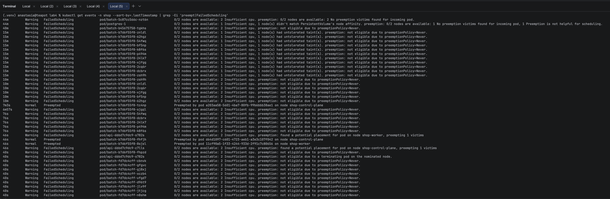

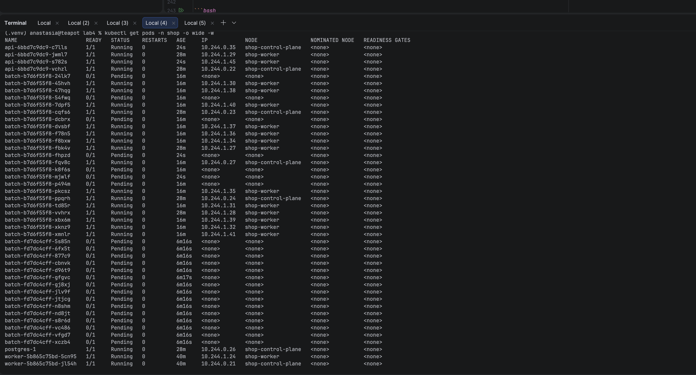

## Часть 7. Давление по памяти

`batch.memoryMB: 600` при лимите 768Mi и request 32Mi. В сумме это больше, чем память нод.

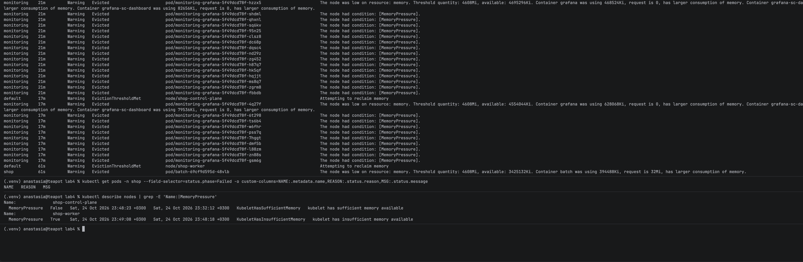

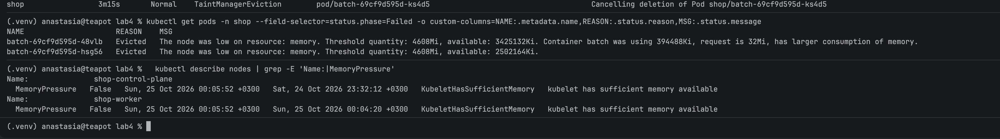

На ноде `shop-worker` появился `MemoryPressure=True`, и kubelet выселил поды batch. Каждый держал около 385 МиБ при request 32Mi, то есть превышал requests сильнее всех и имел самый низкий приоритет (-100). `api` и `postgres-1` остались в `Running`: у Guaranteed потребление не превышает requests, и они в конце очереди. Причина в QoS и приоритете, а не в отсутствии лимитов. Лимит у batch был, и он его не превысил (385 МиБ при лимите 768Mi).

Первая попытка прошла иначе. Тогда у batch был memory request 128Mi при фактических 70 МиБ, а у Prometheus и Grafana requests не было совсем. При давлении kubelet первыми выселил Prometheus и Grafana (`request is 0, has larger consumption of memory`), а batch не тронул, хотя у мониторинга приоритет выше (0 против -100):

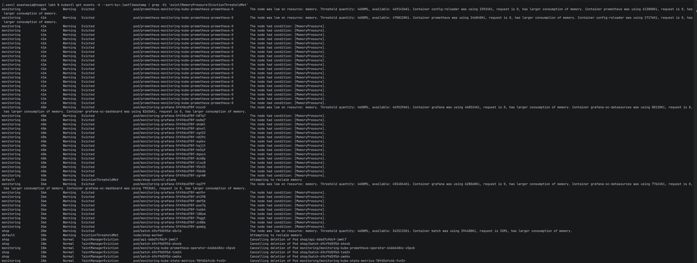

Так вышло из-за порядка критериев: сначала проверяется превышение requests, и только потом приоритет. batch укладывался в свои requests, мониторинг нет. Исправлено двумя правками: batch получил memory request 32Mi, заведомо ниже реального потребления, а Prometheus и Grafana получили requests на уровне фактического потребления ([kps-values.yaml](kps-values.yaml)). Получается, низкий priorityClass без правильных requests не гарантирует, что под выселят первым.

Кроме того, при 10 подах по 600 МиБ на Docker Desktop с 8 GB зависла вся VM Docker. Двум нодам и самой VM не хватило памяти, VM ушла в swap раньше, чем kubelet успел выселить поды. После этого в [kind-config.yaml](kind-config.yaml) порог изменён на `memory.available: 60%` для VM на 12 GB (около 2.4 ГБ остаётся самой VM), а batch набирает память медленнее (`stepMB: 5`).

Evicted и OOMKilled это два разных случая:

| | Evicted (давление на ноде) | OOMKilled (собственный лимит) |
|---|---|---|
| Кто убивает | kubelet по порогу `evictionHard` | ядро, когда cgroup контейнера упирается в `limits.memory` |
| Причина | ноде не хватает памяти в сумме, под мог быть в пределах своего лимита | контейнеру нужно больше своего лимита |
| Статус | под `Failed`, `reason: Evicted`, удаляется с ноды, контроллер создаёт новый (возможно, на другой ноде) | контейнер перезапускается в том же поде, `Last State: OOMKilled`, exit 137, растёт `RESTARTS`, дальше CrashLoopBackOff |
| Состояние ноды | `MemoryPressure=True` | `MemoryPressure=False` |
| Что делать | добавить ёмкость, приблизить requests к факту, настроить приоритеты | поднять лимит или искать утечку |


## Часть 8. SLA под нагрузкой

SLA: 95% заказов (`POST /order`) обрабатываются быстрее 300 мс, ошибок меньше 1%, в том числе во время перегрузки. Те же пороги заданы в thresholds k6 и в алертах.

SLA выполнен со второй попытки. Первый прогон не прошёл (p95 3.0 с, 6.96% ошибок). По метрикам нашлась причина, после исправления (пул соединений и больше ресурсов для postgres) повторный прогон дал p95 36.78 мс и 0.07% ошибок.

### Первый прогон

Нагрузка: k6, 30 заказов/с, 30 минут (00:55-01:25). Перегрузка: в 00:59 `batch.replicas: 30`, в 01:00 `api.replicas: 4` (preemption из Части 6).

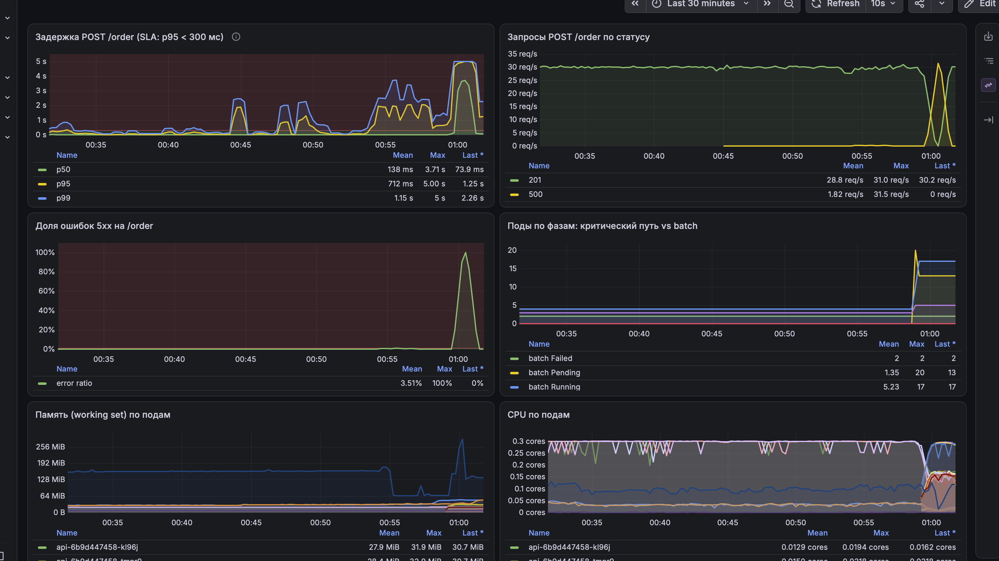

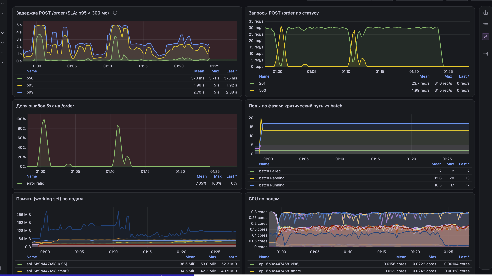

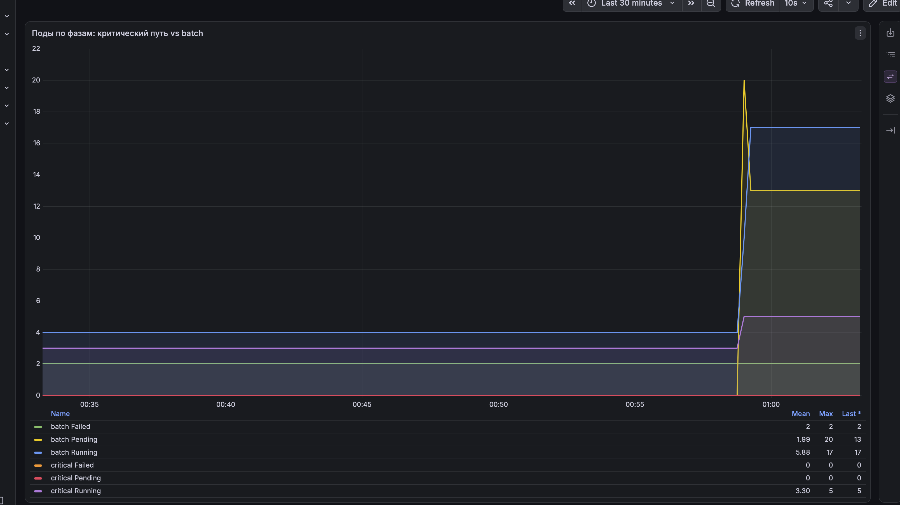

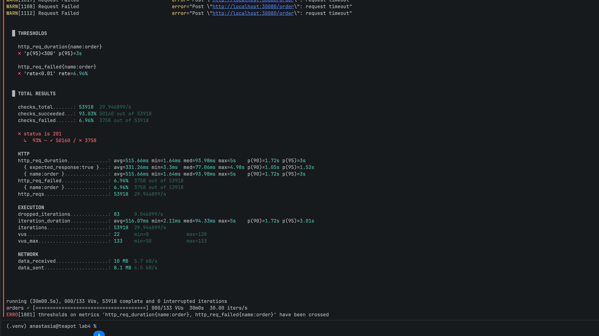

Числа из Prometheus (гистограмма `http_request_duration_seconds` в api):

| Интервал | p50 | p95 | Ошибки | batch |
|---|---|---|---|---|
| без нагрузки batch, 00:30-00:44 | 6 мс | 97 мс | 0% | 4 Running |
| перегрузка, 01:03-01:10 | 46 мс | 1.82 с | 0.7% | 17 Running / 13 Pending / 2 Failed |
| перегрузка, 01:14-01:24 | 131 мс | 1.80 с | 0% | 17 Running / 13 Pending / 2 Failed |
| вся перегрузка с рестартами postgres, 00:59-01:25 | 103 мс | 3.57 с | 8.4% | |
| итог k6 за 30 минут | 94 мс | 3.0 с | 6.96% | |

Без перегрузки SLA выполняется с запасом (p95 97 мс), под перегрузкой нет. batch деградировал как и планировалось: 13 подов в `Pending`, часть вытеснена и выселена, а критический путь в `Pending` не попадал ни разу (на панели «Поды по фазам» `critical Pending = 0`). Но задержка заказа выросла примерно в 20 раз, и было два периода со 100% ошибок.

Что показали метрики:

- Периоды со 100% ошибок в 01:01 и 01:11 совпадают с рестартами `postgres-1`. В 01:01 он не прошёл liveness-пробу (`Get https://...:8000/healthz: read: connection reset by peer`), в 01:10:40 получил `OOMKilled` по своему лимиту 256Mi. Пока postgres поднимался, заказы падали.
- postgres упирался в CPU-лимит: при лимите 150m троттлилось 30-64% CFS-периодов. Каждый заказ открывал новое соединение, то есть `fork` backend-процесса и SCRAM-аутентификацию. Пока backend'ы ждали CPU, их становилось больше, росла память, и в итоге случился OOM.
- Без перегрузки этого не было, потому что krr измерял postgres без конкуренции за CPU. В kind обе ноды делят 4 ядра VM Docker, и 17 подов batch по 300m (5.1 ядра спроса) отнимают процессорное время даже у Guaranteed-подов. `cpu.weight` по requests делит CPU только внутри одной ноды, а не между контейнерами-нодами на одном хосте.

Guaranteed и высокий приоритет защитили критический путь от вытеснения (его не тронули ни preemption, ни eviction), но не от собственного лимита. CPU-лимит на уровне p95 из спокойного режима оказался потолком, в который postgres упёрся при первой конкуренции. Для SLA под перегрузкой нужно:

1. Перестать открывать соединение на каждый заказ: пул соединений в api (`psycopg2.pool`) вместо `connect()` на запрос.
2. Дать postgres запас относительно krr: CPU 300m, память 512Mi. krr показывает потребление в спокойном режиме, а не размер под перегрузку.
3. Повторить прогон k6 и сравнить.

### Исправление и повторный прогон

Изменения:

- api 1.3.0 с пулом соединений ([api/app.py](api/app.py)): `ThreadedConnectionPool` на 10 соединений на реплику и семафор, чтобы запрос ждал свободное соединение, а не падал. postgres больше не делает `fork` и SCRAM на каждый заказ, число backend'ов ограничено (4 реплики по 10 = 40 при `max_connections = 100`). Соединение, на котором произошла ошибка (например, после рестарта postgres), закрывается и не возвращается в пул. Проверено на отдельном postgres: 60 одновременных заказов через пул из 3 соединений дали 60 ответов 201 при 2 backend'ах; после рестарта postgres упал один запрос, следующие прошли.
- postgres 300m / 512Mi (Guaranteed). Числа krr (111m / 107Mi) это нижняя граница для спокойного режима, критическому пути нужен запас под конкуренцию за CPU и рост числа backend'ов.

Нагрузка: k6, 30 заказов/с, 35 минут (02:02-02:37). Что происходило в кластере (по `helm history` и метрикам):

| Время | Действие | Состояние |
|---|---|---|
| 02:02-02:04 | без изменений | api 4 реплики (Guaranteed, остались после Части 6), batch 4 Running |
| 02:04:39 | `batch.replicas: 30` | 15 batch Running, 15 Pending (`Insufficient cpu`, `preemptionPolicy=Never`) |
| 02:07-02:12 | | `ShopPodsPending` в состоянии firing (15 подов) |
| 02:12-02:13 | `batch.memoryMB: 600`, затем откат | batch набрал около 300 МиБ, давления по памяти не возникло |
| 02:13:27 | `batch.replicas: 5`, `memoryMB: 16` | спокойный режим до конца прогона |

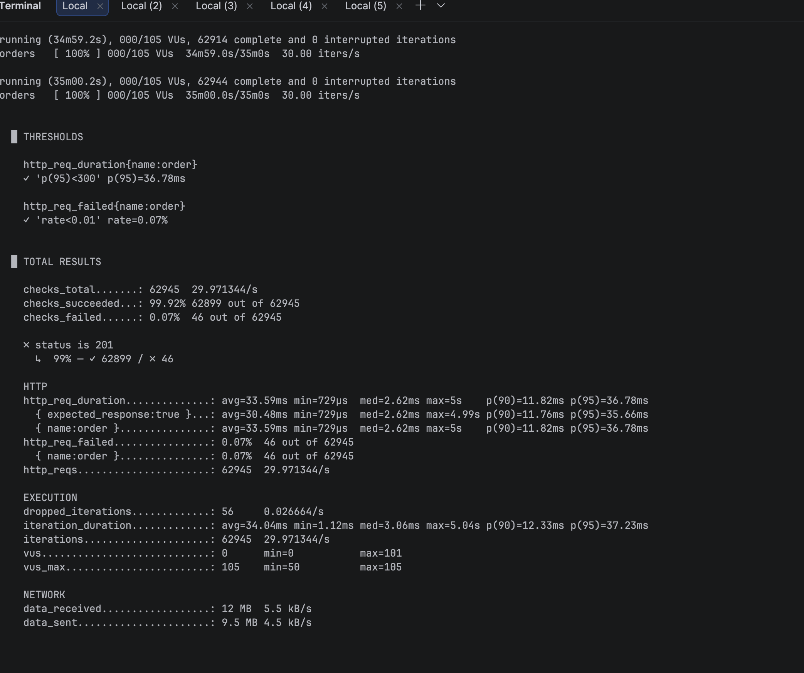

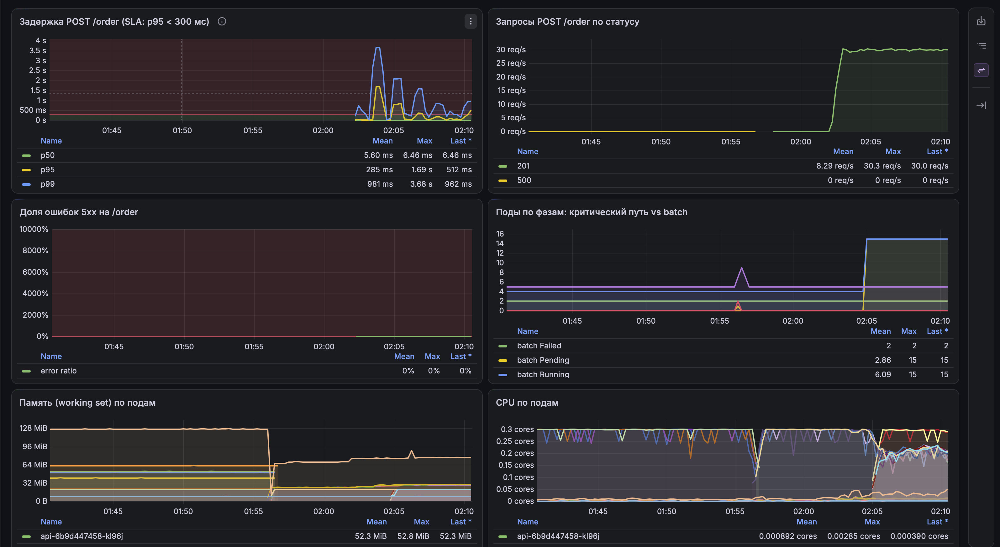

Числа из Prometheus и k6:

| | До исправления | После исправления |
|---|---|---|
| p95 без перегрузки | 97 мс | 10 мс (02:13-02:37) |
| p95 при перегрузке по CPU (batch 30, Pending) | 1.82 с | 154 мс (02:05-02:13) |
| p99 при перегрузке по CPU | | 868 мс |
| ошибки 5xx на `/order` | 8.4% | 0 |
| итог k6: p95 / failed | 3.0 с / 6.96% | 36.78 мс / 0.07% |
| рестарты `postgres-1` за прогон | 2 (liveness и OOMKilled) | 0 |
| троттлинг postgres | 30-64% периодов | меньше 10% |
| CPU postgres при 30 заказах/с | 110-130m | 20-40m |
| память postgres | до 256Mi, затем OOMKilled | 70-87 МиБ из 512Mi |

После исправления SLA выполняется под перегрузкой. Итог k6 за 35 минут: p95 36.78 мс при пороге 300 мс и 0.07% неуспешных запросов при пороге 1%. Ни один из двух critical-алертов не сработал. Деградировал только batch: половина его подов была в `Pending`, сработал warning `ShopPodsPending`.

Основной эффект дал пул соединений. CPU postgres при той же нагрузке снизился с 120m до 20-40m, примерно в 4 раза, потому что больше нет `fork` и SCRAM-аутентификации на каждый заказ. Число backend'ов фиксировано, память postgres стабильна (до 87 МиБ). Дополнительные ресурсы postgres (300m / 512Mi) убрали троттлинг, а вместе с ним провалы liveness-пробы и рестарты.

## Часть 9. Мониторинг

Шаблоны: [servicemonitor.yaml](shop/templates/servicemonitor.yaml) (метрики `api` с `/metrics`), [prometheusrule.yaml](shop/templates/prometheusrule.yaml), [grafana-dashboard.yaml](shop/templates/grafana-dashboard.yaml) (ConfigMap с [shop-sla.json](shop/dashboards/shop-sla.json), Grafana подхватывает его через sidecar).

Дашборд «Shop — SLA критического пути»: задержка p50/p95/p99 с линией SLA, запросы по статусам, доля ошибок, поды по фазам (критический путь отдельно от batch), память и CPU по подам, троттлинг api и postgres, выселения и рестарты. Скриншоты дашборда в Части 8.

Алерты:

1. `OrderLatencySLABreach` (critical): p95 `POST /order` больше 300 мс в течение 2 минут. Это и есть SLA по задержке. `for: 2m` отсекает короткие всплески (GC, старт пода).
2. `OrderErrorRateHigh` (critical): доля 5xx на `/order` больше 1% в течение 2 минут. Это вторая половина SLA: быстрый ответ с ошибкой не считается успешным заказом. Срабатывает при падении postgres, нехватке соединений, OOM в api. Считается доля, а не абсолютное число ошибок, чтобы порог не зависел от трафика.
3. `ShopPodsPending` (warning): под в namespace `shop` находится в `Pending` больше 2 минут. Сигнал о нехватке ёмкости по requests. Если в `Pending` только batch, это ожидаемо, поэтому уровень warning. Если там окажутся `api` или `postgres`, значит, у критического пути нет резерва и отказ следующей ноды ударит по SLA.

Срабатывания в первом прогоне Части 8 (по `ALERTS{alertstate="firing"}` в Prometheus):

| Алерт | Firing | Причина |
|---|---|---|
| `OrderLatencySLABreach` | 00:50-01:25 | p95 больше 300 мс под перегрузкой |
| `OrderErrorRateHigh` | 01:02-01:14 | рестарты postgres-1 (liveness, OOMKilled) |
| `ShopPodsPending` | 01:01-01:28, 13 подов `batch-*` | batch не поместился по CPU requests |

Все три сработали: два critical отразили реальное нарушение SLA, warning показал, что в `Pending` находится только batch.

В повторном прогоне (после исправления) в состоянии firing был только `ShopPodsPending` (02:07-02:12, 15 подов batch). Оба critical-алерта остались inactive, SLA не нарушался:

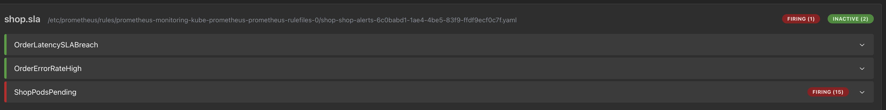
