# Лабораторная 5
## Часть 0
Выбираем в качестве CNI Cilium из-за более широкого функционала (Hubble предоставляет встроенную карту трафика и flow-логи)

## Часть 1
Пришлось поднять новый кластер, потому что по умолчанию в kind свой CNI, который игнорирует NetworkPolicy.

При создании нового в конфигах прописываем явно для отключения kindnet
```
networking:
  disableDefaultCNI: true
  podSubnet: "10.244.0.0/16"
```
Смотрю адреса апишек
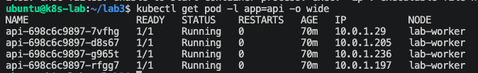

Скриншот ниже подтверждает, что под управляется Cilium.
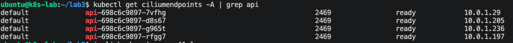

Далее пытаемся найти адреса api со стороны ноды, нооо найти под по АйПи на хосте невозможно, потому что на хостовой стороне lxc* Cilium не назначает IPv4, потому что маршрутизация выполняется через eBPF-программы и карты, а не через обычную маршрутизацию по IP на интерфейсе (такой дизайн).
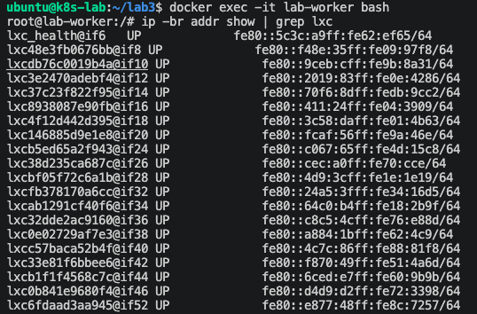

Далее нужно протестировать видимость подов на разных нодах. Поскольку все рабочие поды стоят на ноде lab-worker, попробуем с нее пропинговать CoreDNS, размещенный на lab-control-plane. Сначала узнаем IP пода CoreDNS
```
ubuntu@k8s-lab:~/lab3$ kubectl get pods -n kube-system -o wide | grep coredns
coredns-7db6d8ff4d-gs9qk                    1/1     Running   0          4h56m   10.0.0.106   lab-control-plane
```
Затем поднимаем отладочный контейнер с netshoot внутри api-пода на worker. Все отлично, пропинговали без потери пакетов, видимость подов на разных нодах есть.
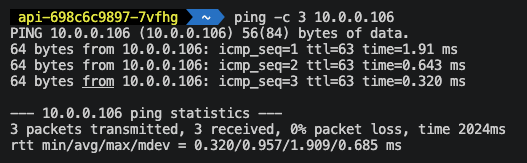

## Часть 2
Поднимаю внешнюю точку входа, NodePort. Для этого поправил конфиги values.yaml и api-service.yaml.
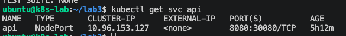

Отличия инструментов:
  - NodePort открывает один и тот же порт (30080) на каждой ноде кластера. Внешний клиент стучится на IP-ноды:30080, и трафик перенаправляется на поды. Это работает локально, без облака.
  - LoadBalancer — надстройка над NodePort, которая просит облачного провайдера выделить реальный внешний IP. 
  - Headless (clusterIP: None) не даёт виртуального IP. DNS возвращает IP-адреса всех подов напрямую. Используется, когда клиенту нужны конкретные экземпляры (например, для StatefulSet вроде Postgres), а не балансировка

Запускаю скрипт с удалением пода, параллельно отправляя запросы на http://localhost:30080/health
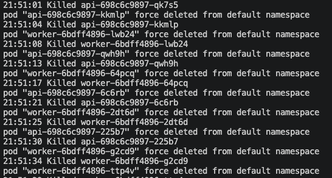

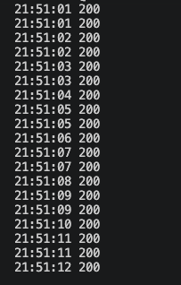

Все ответы с кодом 200. 

Объяснение магии:

  - CoreDNS - DNS-сервер кластера: превращает имя в адрес. Клиент обращается к http://localhost:30080/health. NodePort знает, что этот трафик нужно направить в сервис api. DNS тут не участвует напрямую (клиент стучится на IP ноды), но внутри кластера поды api находят postgres по имени postgres-rw, а CoreDNS отдаёт адрес сервиса.
  - Service (ClusterIP): У сервиса api есть виртуальный IP, который не меняется, даже когда поды умирают. Клиент (через NodePort) всегда попадает на этот стабильный адрес
  -EndpointSlice: Kubernetes автоматически обновляет список живых подов (их IP), которые стоят за сервисом. Когда скрипт убивает под, EndpointSlice убирает его IP. Когда Deployment создаёт новый под, EndpointSlice добавляет его новый IP
  -kube-proxy (или Cilium): читает EndpointSlice и настраивает правила на ноде, чтобы трафик с ClusterIP перенаправлялся на актуальные IP подов. Пока в списке есть хотя бы один живой под, запросы проходят

  В kind по умолчанию используется iptables. Разница с IPVS, который заточен под балансировку, будет заметна на кластере с тысячей сервисов. На небольших кластерах разница не ощутима.

  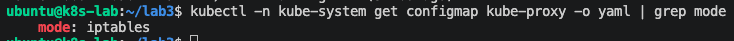

## Часть 3 Матрица доступа

| Направление | Порт/Протокол | Обоснование |
| :--- | :--- | :--- |
| api -> postgres | 5432/TCP | api пишет заказы в БД |
| worker -> postgres | 5432/TCP | читает и помечает заказы |
| любой другой под -> postgres | нет | zero-trust: БД доступна только своим |
| внешний клиент (NodePort) -> api | 8080/TCP | клиент оформляет заказы |
| любой под -> CoreDNS(kube-system) | 53/UDP+TCP | без DNS сервисы не находят друг друга |
| api/worker -> остальное | Нет | default-deny |

## Часть 4
Переходим к реализации матрицы в NetworkPolicy. Делаем по принципу "сначала запретить все, а разрешить нужное".
Добавляем секцию с параметрами для NetworkPolicy в файлик values.yaml
Далее создаем шаблоны networkpolicy-default-deny.yaml (основа для zero trust), networkpolicy-allow-dns.yaml (чтобы поды находили друг друга), networkpolicy-postgres.yaml (разрешает только входящий трафик от api или worker), networkpolicy-api.yaml (входящйи трафик от всех, исходящий - только к БД), networkpolicy-worker.yaml (входящий запрещен, исходящий - только к БД)

Возникла проблема со связью между CNPG и подом с Postgres, дополнительно создал networkpolicy-cnpg-webhook.yaml. После перезапуска CNPG удалось сделать helm upgrade.
Политики применились
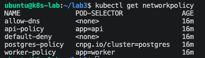

## Чвсть 5
Погнали проходить матрицу
Поскольку в образах api и worker (на базе python:3.11-slim) нет ни curl, ни nc, ни psql, напрямую с них проверку выполнить невозмонжо. Поэтому запустим временный отладочный под в том же namespace (default), на который действуют те же NetworkPolicy, и уже из него проверим все маршруты. Используем образ nicolaka/netshoot для отладки сетей.

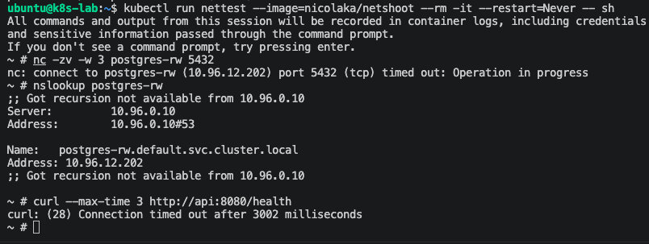
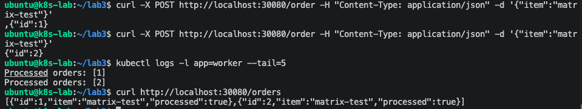

Попробуем протестировать доступ к БД с временного пода
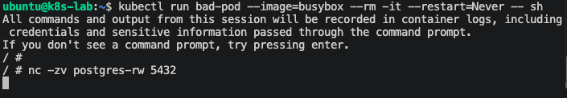

Из временного пода bad-pod (без метки app=api или app=worker) после попытки подключения к postgres-rw:5432 через nc -zv команда не вернула ни succeeded, ни connection refused, а зависла. Это означает, что пакеты были отброшены NetworkPolicy

✅ api -> postgres - запись в БД идет
✅ worker -> postgres - воркер обрабатывает заказы
✅ любой другой под -> postgres - nc: connect to postgres-rw (10.96.12.202) port 5432 (tcp) timed out: Operation in progress
✅ любой под -> CoreDNS(kube-system) - получили адрес, все ок
✅ внешний клиент (NodePort) -> api - получаем список заказов
✅ api/worker → остальное - заблокировано (default-deny; egress разрешён только к postgres (порт 5432). Косвенно подтверждено: nettest → postgres timeout, api → postgres соединение устанавливается)

## Часть 6
Ломаем policy случайным скриптом.
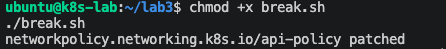

По карте трафика видим, что отбрасываются пакеты от api к Postgres. Для диагностики заходим в api-policy и видимо некорректный порт доступа к Postgres. Фиксим, дергаем ручку - работает. В карте трафика запросы не дропаются.
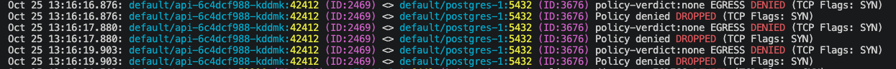

## Часть 7
Добавил алерты в prometheusrule.yaml

  -ApiNoReadyReplicas — если у api нет готовых реплик, клиент не может оформить заказ. Это прямой удар по бизнес-функции. Критичный алерт.
  -PostgresNoReadyReplicas — без базы данных api и worker бесполезны. Это фундамент, отказ которого ломает всё. Критичный.
  -NetworkPolicyNoPods — если CNI не применил политику, zero-trust не работает, и трафик может ходить там, где не должен. Warning, потому что это не мгновенный отказ сервиса, но нарушение безопасности.

  Для проверки уберем реплики Api. Срабатывает алерт. После возвращения реплик алерт пропадает.
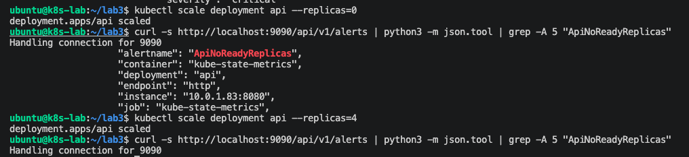
