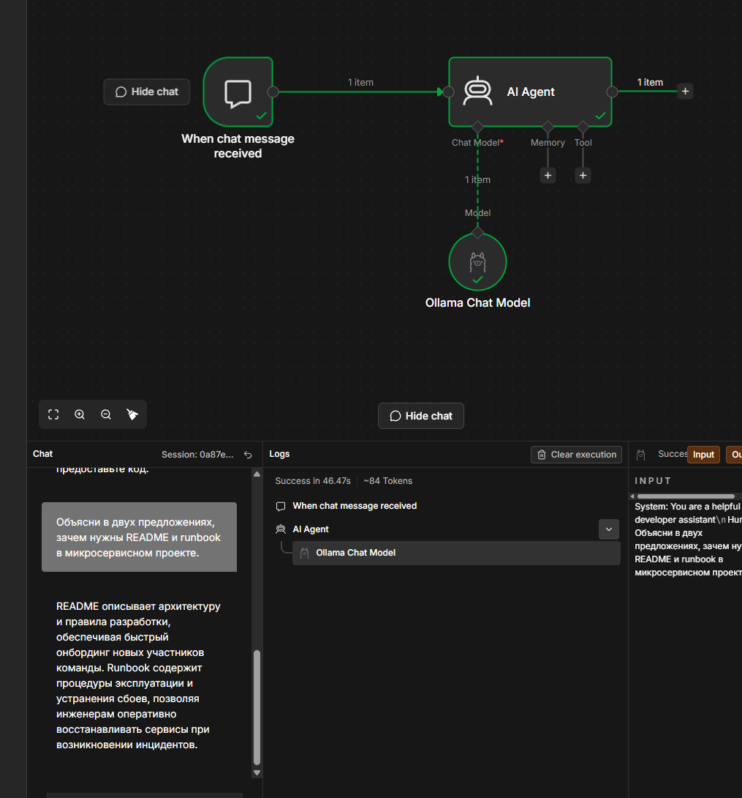
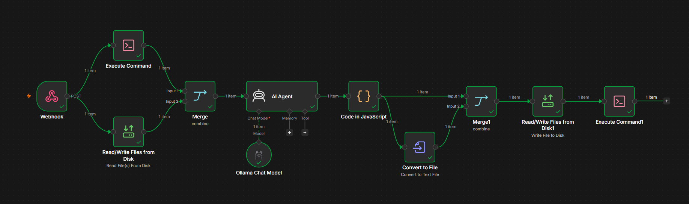
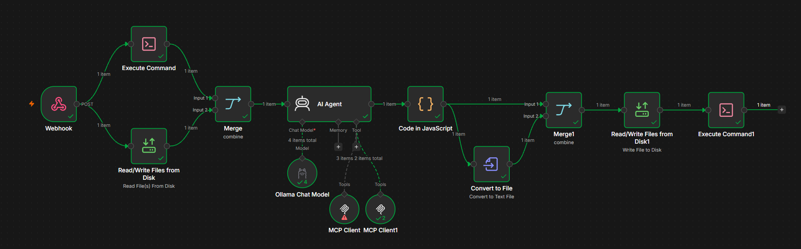
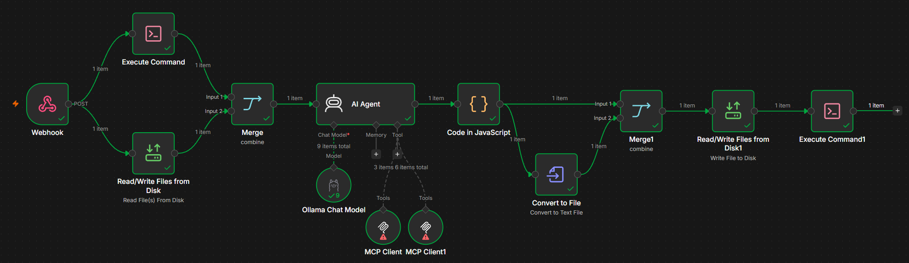
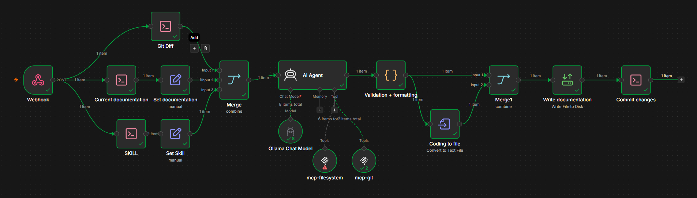
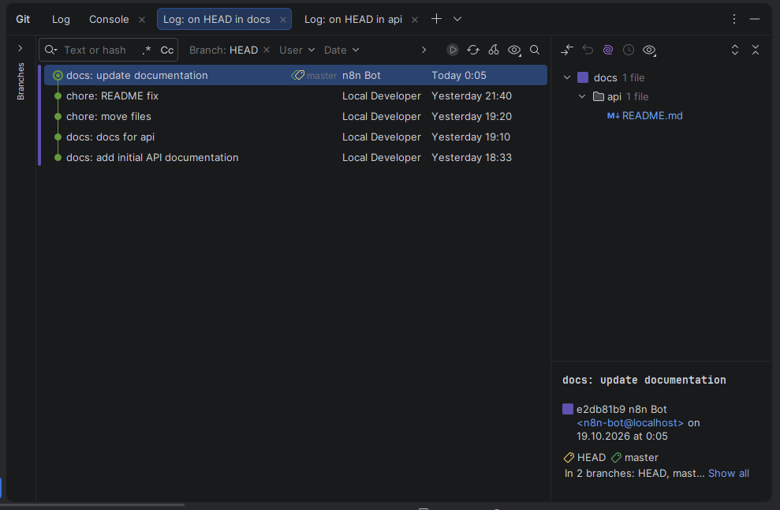
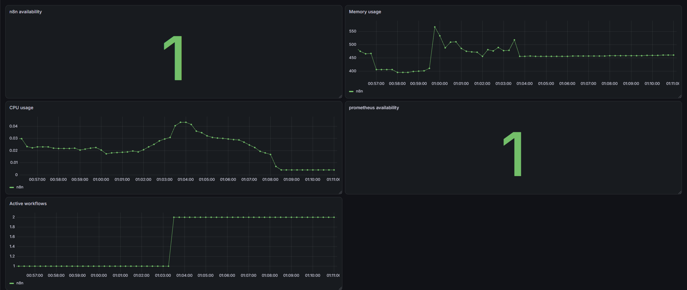

# Лаба 8 — Автоматизация devops-процесса с n8n + AI

## Часть 1 — Придумай кейс
Имеется команда из 15 человек, делает модный B2B SaaS-стартап, которых нет на рынке по мониторингу бизнес-метрик. В команде используют GitLab для кода и документации.
Имеется несколько микросервисов, каждый со своей документацией

Проблема: документация быстро устаревает. Разработчики меняют код, но ленятся и редко обновляют документацию.
Во время сбоя дежурный sre постоянно сталкивается с тем, что документация только путает, а ранбуки не решают проблем. Решение - документация меняется AI при каждом мерже в master. Таким образом она всегда будет актуальна.

* Кому это помогает? Это будет полезно в первую очередь команде разработки и devops-инжинерам. Отпадает необходимость погружаться в код, что позволяет быстро решать возникающие проблемы. Так же это будет полезно аналитикам для понимания работы сервиса 
* Какую проблему решает? Документация и ранбуки быстро теряют свою актуальность -> ими невозможно пользоваться. Используя AI мы поддерживаем их актуальность
* Почему сейчас это неудобно делать руками? Очевидно, никто не любит писать документацию
* Что именно делает автоматизация от начала до конца: триггер → шаги → результат?
  1. Разработчик мержит в мастер новый коммит
  2. В прогоне пайплайна запускается workflow в n8n
  3. AI-агент смотрит на коммит и анализирует его
  4. AI-агент корректирует текущую документация на основе изменений в коде
  5. Проводится валидация markdown
  6. Коммит в репозиторий с документацией

## Часть 2 — Что должно быть в реализации
### Триггер
Поднимаем n8n локально через докер
```commandline
docker run -it --rm  --name n8n  -p 5678:5678  \
  -e GENERIC_TIMEZONE="Europe/Moscow"  -e TZ="Europe/Moscow"  \
  -e N8N_ENFORCE_SETTINGS_FILE_PERMISSIONS=true  \
  -v n8n_data:/home/node/.n8n  \
  n8nio/n8n
```
Локально уже имелась ollama. В n8n создали тестовый workflow, проверили подключение и работу


Потом создали 2 репозитория [api](api) и [docs](docs).
Тут нужно было подключить эти папки в n8n, поэтому переписали с использованием docker-compose, репозитории перенесли как volume.


Далее создали workflow, как на картинке



Теперь поднимем и подключим MCP-сервера. Добавили mcp-git и mcp-filesystem в docker-compose. mcp-git позволяет агенту использовать git, mcp-filesystem позволяет читать файлы в системе.
Подключаем их в n8n, проверяем результат


Теперь выберем набор тулов, которые мы можем разрешить, т.к. например запись файла через mcp-filesystem разрешать нельзя. Мы не хотим править документацию через него.
Был выбран следующий AI toolkit:
1. read_text_file - для чтения документации и кода
2. list_directory - для понятия того, какие файлы существуют
3. git_diff - сбор изменений в коммитах
4. git_log - посмотреть историю коммитов
5. git_show - посмотреть контент коммита
Так мы позволим AI-агенту собирать дополнительную информацию, но запретим ему как-либо менять репозиторий. Проверяем


Теперь создадим SKILL.md. Частично перенес старый System message из n8n. Теперь необходимо отредактировать workflow и добавить туда чтение скила. Так же переделаем изначальное получение данных. Итого получаем следующий конечный workflow


1. Webhook - триггер. ci в gitlab дергает метод в пайплайне, в рамках лабороторной вызов происходит руками через curl
2. Git Diff - берутся последние коммиты и их изменения
3. Current documentation - читается актуальная документация, Set documentation - мапим stdout в новое поле
4. SKILL - читается SKILL.md, Set Skill - мапим stdout в skill
5. Merge - собираются все данные
6. AI Agent - происходит обогащение промпта [systemMessage](systemMessage.txt). В нем используется skill.md. В самом промпте передается git diff и текущая документация
7. mcp-filesystem, mcp-git - mcp-клиенты к mcp-filesystem и mcp-git
7. Validation + formatting - промптом четко зафиксировали ответ AI-агента в формате json, происходит парсинг этого ответа
8. Coding to File - конвертация новой документации в байты для записи
9. Merge1 - собираем ответ от javaScript и байты для записи
10. Write documentation - записываем новую документацию
11. Commit changes - коммитим изменения
Важно, чтобы в запросе передавали в теле поле repository, по нему строятся команды и промпты

Теперь пройдемся по чеклисту
- [x] **Триггер** - вебхук
- [x] **И AI-, и не-AI-шаги.**. AI-шаг - генерация документации, неAI-шаги - чтение файлов, запись файлов, коммит изменений
- [x] **Минимум два MCP-сервера**: mcp-git, mcp-filesystem
- [x] **AI toolkit на 3–5 инструментов.**: read_text_file, list_directory, git_diff, git_log, git_show
- [x] **Описанные skills.** [SHILL.md](SKILL.md)
- [x] **Конкретный результат** - изменений документации

## Часть 3 — Запусти локально
Поднял, запустил. Проверял следующий тест - добавил в последнем коммите ендпоинт /version, в документации после запуска появился коммит с описанием этого эндпоинта

Пришлось убрать git в api и docs, но можно обратно переименовать из git в .git. А так вот скриншот истории в docs


Сам [workflow](workflow.json)

## Часть 4 — Мониторинг (обязательно)
Построили следующие дашборды:
1. up{job="n8n"} - доступность n8n
2. up{job="prometheus"} - доступность prometheus
3. rate(n8n_process_cpu_seconds_total{}[5m]) - использование cpu
4. n8n_process_resident_memory_bytes{} / 1024 / 1024 - использование memory в Гб
5. n8n_active_workflow_count{} - количество активных workflow


Алерты:
* `up{job="n8n"} == 0` - n8n недоступна, ничего не работает, нужно чинить
* `up{job="prometheus"} == 0` - prometheus недоступен, ничего не работает, нужно чинить
* `n8n_active_workflow_count == 0` - почему-то активные доступные workflow пропали
* `n8n_process_resident_memory_bytes > 1073741824` - n8n потребляет более 1 Гб памяти, слишком много, потенцильно можно упереться в лимиты